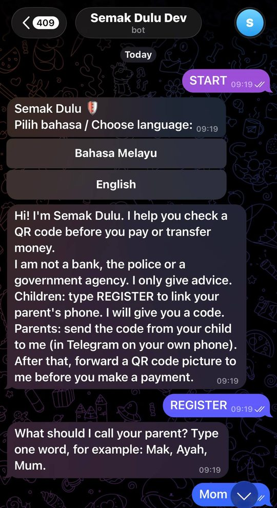
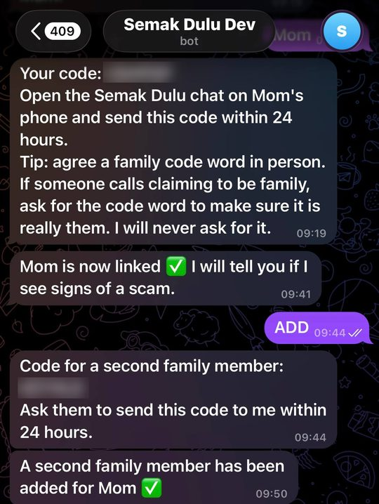

# Semak Dulu 🛡️

**Semak Dulu** ("Check First") is a Telegram bot that helps Malaysian seniors check a payment QR code **before** they pay. When a scammer calls pretending to be a bank, the police, a court or a courier and sends a QR code, the senior forwards the QR to Semak Dulu. The bot asks one question, gives a clear answer (🛑 **DO NOT PAY** or 🟡 **Wait**), and alerts a family member when it matters.

> 🤖 **Try the bot:** [@semakdulu_dev_bot](https://t.me/semakdulu_dev_bot) (see [Try it yourself](#try-it-yourself))

<p align="center">
  
  &nbsp;
  
</p>

---

## Contents

1. [The problem](#the-problem)
2. [How it works](#how-it-works)
3. [Try it yourself](#try-it-yourself)
4. [Safety and privacy principles](#safety-and-privacy-principles)
5. [Architecture](#architecture)
6. [Repository structure](#repository-structure)
7. [Run it locally](#run-it-locally)
8. [Deploy your own copy](#deploy-your-own-copy)
9. [Documentation](#documentation)
10. [Limitations and future work](#limitations-and-future-work)
11. [Team](#team)
12. [AI tools usage](#ai-tools-usage)
13. [License](#license)

---

## The problem

In a "trusted caller" scam, someone phones a senior and claims to be from a bank, the police, a court or a courier company. They create panic ("your account is frozen", "there is a warrant", "your parcel is held") and send a DuitNow QR code to "settle" the problem. Under pressure, the senior pays.

Seniors are often alone when this happens, and they rarely know how to check who a QR code really pays. Semak Dulu adds one simple habit: **forward the QR first**. It takes one forward and one tap.

## How it works

### Setup (once, about 2 minutes, during a family visit)

1. The adult child opens the bot, picks **Bahasa Melayu** or **English**, and types `DAFTAR` (or `REGISTER`).
2. The bot asks how to address the parent (for example _Mak_, _Ayah_, _Mum_) and gives a 6-character code.
3. On the parent's phone, the parent opens the bot, picks a language and sends the code.
4. The parent reads a short consent notice and taps **Setuju / I agree**. The two phones are now linked.
5. The parent does one **practice check** (no alert is sent), so the first real use is not the first use.
6. The family agrees a **family code word** out loud. The bot never asks for it and never stores it.
7. Optional: the child types `TAMBAH` (or `ADD`) to invite a **second family member** as a backup contact.

### A check (every time someone asks the parent to pay by QR)

1. The parent forwards the QR picture to the bot.
2. The bot immediately asks: **"Who asked you to pay?"** with three buttons:
   `Bank/Polis/Mahkamah` · `Kurier` · `Keluarga/Kawan/Kedai`
3. Meanwhile, the bot decodes the QR in the background (DuitNow payload, personal or business account, payee name, amount).
4. The bot replies with one of two verdicts. **There is no "safe" verdict.**

| Rule | When                                                                  | Verdict                                                                                    |
| ---- | --------------------------------------------------------------------- | ------------------------------------------------------------------------------------------ |
| V-1  | Caller claims to be a bank, the police or a court                     | 🛑 **DO NOT PAY**: these never ask for payment by QR                                       |
| V-2  | Caller claims to be a courier, and the QR pays a **personal** account | 🛑 **DO NOT PAY**                                                                          |
| V-3  | Caller claims to be a courier, and the QR could not be read           | 🟡 **Wait**: check first                                                                   |
| V-4  | Caller claims to be a courier, and the QR pays a business account     | 🟡 **Wait**: check with the courier's official app                                         |
| V-5  | Family, friend or shop                                                | 🟡 **Wait**: call back on a saved number, ask the family code word, or check the shop name |

5. On a 🛑 verdict, the bot **alerts the adult child**: _"ALERT: Call Mak now."_ The child taps **Saya uruskan / I'm handling it**.
6. If nobody taps within 3 minutes, the bot alerts the second contact (if there is one). If still nobody responds, the bot tells the parent again to call the bank and 997.
7. Every verdict has two follow-up buttons:
   - **I already paid**: step-by-step advice (bank, 997, 999, police report) and an urgent family alert.
   - **Report this QR**: saves an anonymous report inside Semak Dulu, so later users see "this account has been reported". Reports add a warning line but never change the verdict.

### Commands

| Bahasa Melayu | English    | What it does                          |
| ------------- | ---------- | ------------------------------------- |
| `DAFTAR`      | `REGISTER` | Child starts linking a parent's phone |
| `TAMBAH`      | `ADD`      | Child invites a second family member  |
| `BAHASA`      | `LANGUAGE` | Change language                       |
| `BERHENTI`    | `STOP`     | Delete all your data and links        |
| `BANTUAN`     | `HELP`     | Show help                             |

Commands work in both languages. The bot shows the commands of the language the user chose.

## Try it yourself

You need **at least two Telegram accounts on two phones**: one plays the **child**, one plays the **parent**. To test the second family member, you need a **third** account.

**Phone 1 (child)**

1. Open [@semakdulu_dev_bot](https://t.me/semakdulu_dev_bot) and send `hi`.
2. Tap **English** (or Bahasa Melayu).
3. Type `REGISTER`, then a name for the parent, for example `Mum`.
4. Note the 6-character code.

**Phone 2 (parent)**

1. Open the same bot, send `hi` and pick a language.
2. Send the code from Phone 1, then tap **I agree**.
3. Practice check: forward any QR code picture. You will see `[PRACTICE]` and no alert is sent.
4. Real check: forward a DuitNow QR picture (for example, the "receive money" QR from a banking app), then tap a button:
   - **Bank/Police/Court**: 🛑 verdict, and Phone 1 receives an alert.
   - **Courier**: 🛑 if the QR pays a personal account, otherwise 🟡.
   - **Family/Friend/Shop**: 🟡 verdict with the payee name.
5. Try **I already paid** and **Report this QR**.

**Phone 3 (optional second contact)**

1. On Phone 1, type `ADD` and note the new code.
2. On Phone 3, open the bot, pick a language, send the code and tap **Accept**.
3. Trigger a 🛑 check from Phone 2 and do **not** tap on Phone 1. After about 3 minutes, Phone 3 is alerted.

**Good to know**

- The bot never moves money. Nothing you do here pays anyone.
- A parent can run up to 10 checks per 10 minutes.
- To start again, send `STOP` on each phone and tap **Yes, delete data**.
- The bot runs on a development stack for the hackathon and may be switched off after the hackathon.

## Safety and privacy principles

| Principle                            | How it is enforced                                                                      |
| ------------------------------------ | --------------------------------------------------------------------------------------- |
| **Never say "safe"**                 | The verdict type has no SAFE value, and a test scans every message for safety words     |
| **Ask first, decode later**          | The question is sent before decoding, so a blurry photo never blocks a 🛑 verdict       |
| **Same answer every time**           | Fixed rules, no AI model in the verdict                                                 |
| **QR images are never stored**       | Images are decoded in memory and discarded. Pending checks expire after 15 minutes.     |
| **Family code word is never stored** | The bot only reminds families to use it                                                 |
| **Reporters are anonymous**          | Reporter ids are stored only as a keyed hash (HMAC)                                     |
| **Reports never cause a 🛑**         | Reports add a warning line. Only static QRs can be reported.                            |
| **Consent first**                    | No alert is sent about a parent until they tap "I agree". `STOP` deletes everything.    |
| **Short, plain messages**            | Every verdict and alert is tested to fit 10 lines and 700 characters, in BM and English |

## Architecture


1. Telegram sends each message to **API Gateway** (`POST /tg`).
2. The **Ingest Lambda** checks Telegram's secret token, converts the update to one standard event, puts it on an **SQS FIFO** queue (one group per user), and replies "OK" straight away.
3. The **Worker Lambda** takes events from the queue in order, runs the bot logic, decodes QR images, reads and writes **DynamoDB**, and sends replies through the Telegram Bot API.
4. Reminders (2 minutes) and alert escalation (3 minutes) are scheduled on a second, delayed **SQS** queue.
5. Events that fail 3 times go to a **dead-letter queue**. Errors raise a **CloudWatch** alarm.
6. Secrets (Telegram token, webhook secret, report pepper) live in **SSM Parameter Store**.

| Layer                  | Technology                                                         |
| ---------------------- | ------------------------------------------------------------------ |
| Channel                | Telegram Bot API                                                   |
| Compute                | AWS Lambda (Python 3.12), 2 functions                              |
| Queues                 | Amazon SQS FIFO (events), SQS standard (timers), dead-letter queue |
| Database               | Amazon DynamoDB, single table, TTL on                              |
| Secrets                | AWS Systems Manager Parameter Store                                |
| Monitoring             | Amazon CloudWatch logs, metric filter and alarm                    |
| Infrastructure as code | AWS SAM (`template.yaml`), no Docker needed                        |
| QR decoding            | zxing-cpp + Pillow, packaged as a Lambda layer                     |

More diagrams (context, data model, sequences, decode pipeline, verdict flow, escalation) are in [`docs/diagrams/`](docs/diagrams/) and explained in the [SDD](docs/SDD.md).

## Repository structure

```
semak-dulu/
├── src/
│   ├── core/            # all bot logic, no network code
│   │   ├── flows.py         # conversation: setup, checks, buttons, timers
│   │   ├── verdict.py       # rules V-1 to V-5
│   │   ├── emv.py, decode.py, classify.py   # QR decoding and DuitNow parsing
│   │   ├── escalation.py    # family alert chain
│   │   ├── reports.py       # anonymous QR reports
│   │   ├── store.py         # InMemoryStore and DynamoStore
│   │   ├── messages.py      # loads the message catalogue
│   │   └── types.py         # shared data types and interfaces
│   ├── channels/        # Telegram adapter
│   ├── handlers/        # Lambda entry points: ingest.py, worker.py, config.py
│   └── messages/        # ms.yaml and en.yaml: every message the bot sends
├── tests/               # 365 tests (pytest)
├── scripts/             # chat simulator, layer build, QR benchmark
├── docs/                # SRS, SDD, diagrams, screenshots
└── template.yaml        # AWS SAM stack
```

All message text lives in `src/messages/*.yaml`, so wording can change without touching code.

## Run it locally

You need **Python 3.12** and **Git**.

```bash
git clone https://github.com/WolffeyX/semak-dulu.git
cd semak-dulu

# macOS / Linux
python3.12 -m venv .venv
source .venv/bin/activate

# Windows (PowerShell)
py -3.12 -m venv .venv
.venv\Scripts\Activate.ps1

pip install -r requirements-dev.txt
pytest                      # expect: 365 passed, 2 xpassed
```

### Chat with the bot locally (no AWS, no Telegram)

```bash
python scripts/chat_sim.py
```

Each line is one user action:

```
@anak hi                   # user "anak" types text: gets the language buttons
@anak tap 1                # tap button 1 (Bahasa Melayu) of the last message "anak" received
@anak Daftar
@anak Mak                  # the bot replies with a 6-character code
@mak  hi
@mak  tap 1
@mak  <code from anak>
@mak  tap 1                # Setuju (consent)
@mak  img personal         # fake QR: personal | business | dynamic | noqr | url
@mak  tap 1                # first check is [LATIHAN] practice: STOP, but no alert
@mak  img personal         # a real check (or: img path/to/qr.png for a real QR image)
@mak  tap 1                # Bank/Polis/Mahkamah -> STOP, and "anak" gets an alert
timers                     # run reminders and escalation now
quit
```

## Deploy your own copy

**Prerequisites:** an AWS account, [AWS CLI](https://aws.amazon.com/cli/), [AWS SAM CLI](https://docs.aws.amazon.com/serverless-application-model/latest/developerguide/install-sam-cli.html), Python 3.12, and a Telegram bot token from [@BotFather](https://t.me/BotFather).

1. **Build the QR library layer** (once):
   ```bash
   bash scripts/build_layer.sh
   # Windows: powershell -ExecutionPolicy Bypass -File scripts\build_layer.ps1
   ```
2. **Store secrets in SSM** (once per stage):
   ```bash
   aws ssm put-parameter --type SecureString --name /semak/dev/tg_token      --value "<bot token from BotFather>"
   aws ssm put-parameter --type SecureString --name /semak/dev/tg_secret     --value "<any long random text>"
   aws ssm put-parameter --type SecureString --name /semak/dev/report_pepper --value "<another long random text>"
   ```
3. **Build and deploy:**
   ```bash
   sam build                 # inside the Python 3.12 venv; never use --use-container
   sam deploy --guided       # first time only; afterwards: sam build && sam deploy
   ```
4. **Point Telegram at your stack.** Copy the `WebhookTelegram` output from `sam deploy`, then open:
   ```
   https://api.telegram.org/bot<tg_token>/setWebhook?url=<WebhookTelegram>&secret_token=<tg_secret>
   ```
5. Send `hi` to your bot.

Lambda reads secrets at cold start. After changing a secret, redeploy or wait for new containers.

## Documentation

| Document                                           | What it covers                                                                        |
| -------------------------------------------------- | ------------------------------------------------------------------------------------- |
| [Software Requirements Specification](docs/SRS.md) | Users, functional requirements (FR-01 to FR-27), data and non-functional requirements |
| [Software Design Document](docs/SDD.md)            | Architecture, data model, verdict rules, message design, testing, decisions log       |
| [Diagrams](docs/diagrams/)                         | Mermaid sources (`.mmd`) and rendered images (`.png`)                                 |

## Limitations and future work

- **Telegram only.** Most Malaysian seniors use WhatsApp. A WhatsApp channel needs a verified business account and is the first channel to add. The core logic is channel-independent.
- **Personal vs business account** is inferred from the QR's merchant category code. This is based on a small set of samples and still needs wider testing.
- **Reports stay inside Semak Dulu.** They are not sent to the police or NSRC. The bot tells users to call 997 for an official report.
- **Next features:** phishing link check (same forward-to-bot flow), more languages, and smarter report trust.

## Team

| Name                  | Role                                                                                                  |
| --------------------- | ----------------------------------------------------------------------------------------------------- |
| Muhammad Wafi         | **Team Lead & Platform:** AWS SAM stack, Lambda handlers, Telegram channel, deployment and demo video |
| Hana Safiyyah         | **Core engine:** DuitNow QR parsing and checksum, QR decoding, the verdict rules and their tests      |
| Muhammad Nuh Syakirin | **Flows:** setup, check, alert and escalation flows, Malay and English messages, demo script          |
| Danish Irfan          | **Design:** visual design, user journey and chat wireframes, and the pitch deck                       |

## AI tools usage

Claude is used in assisting the development of this project.

## License

This project is licensed under the [MIT License](LICENSE).
