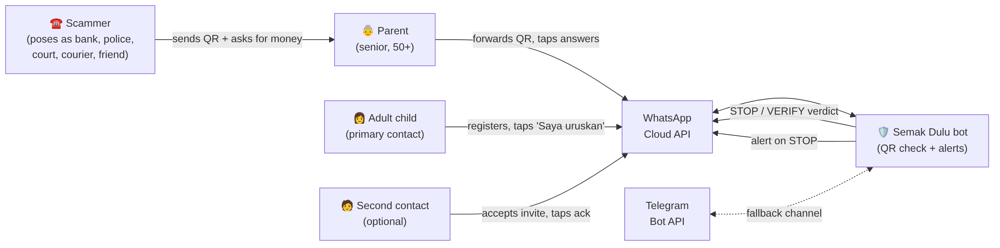
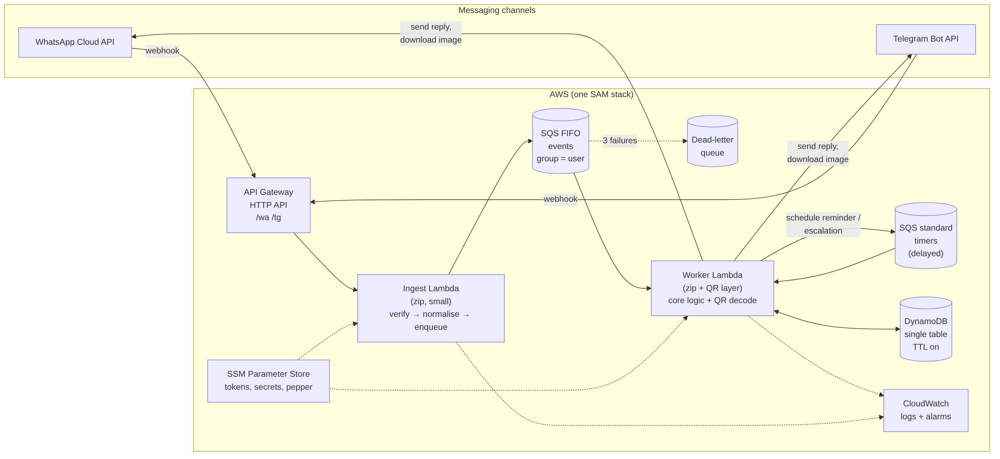
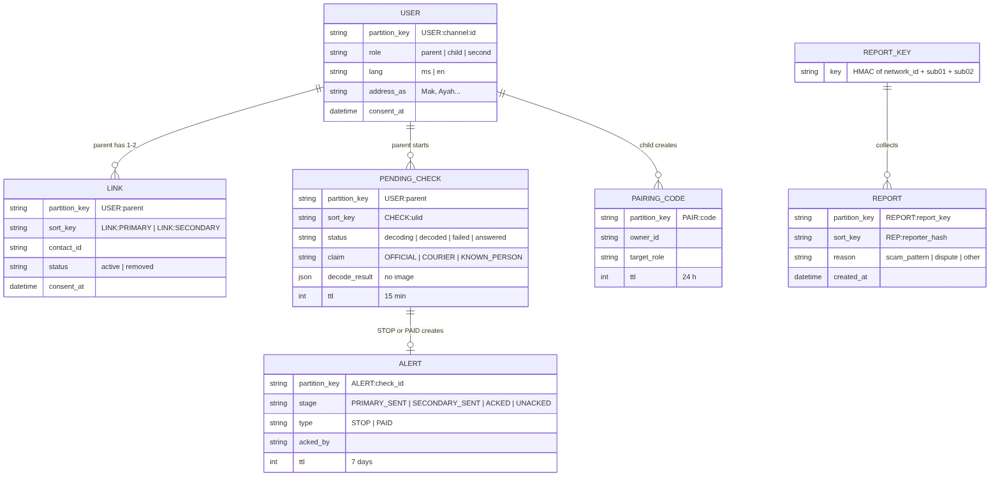
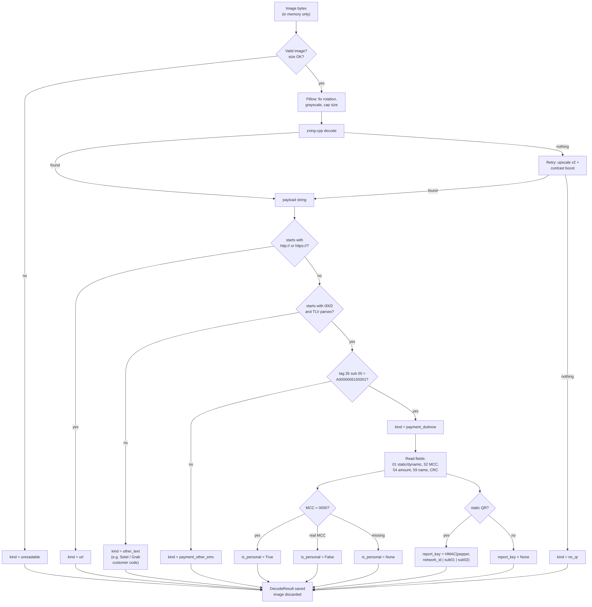
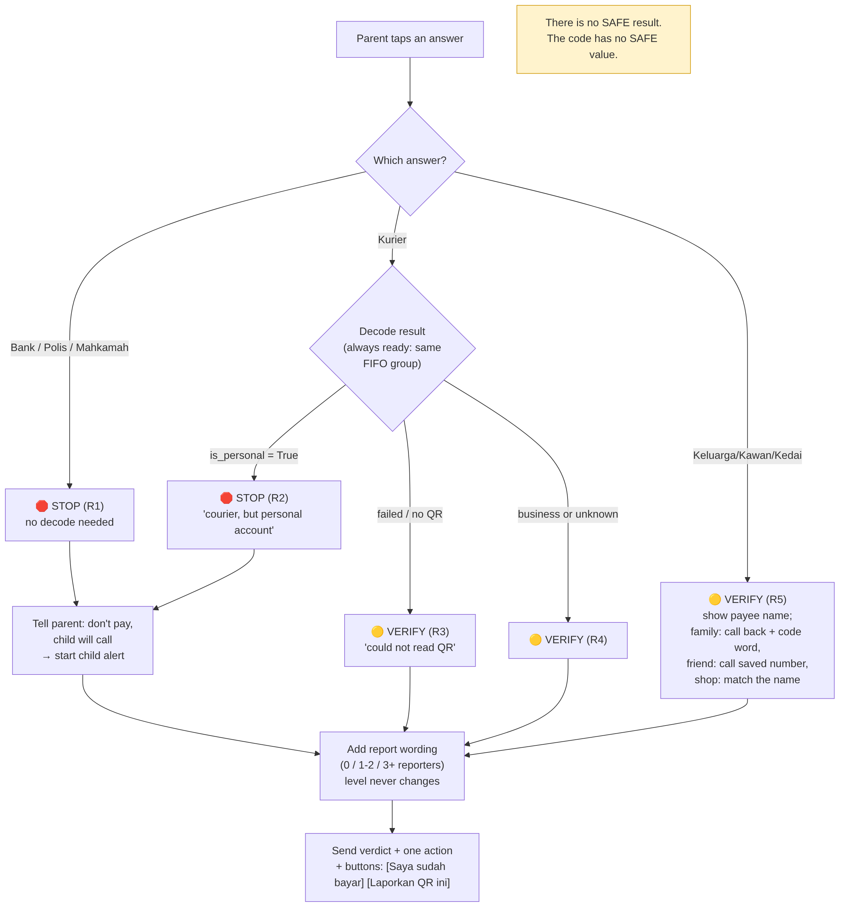
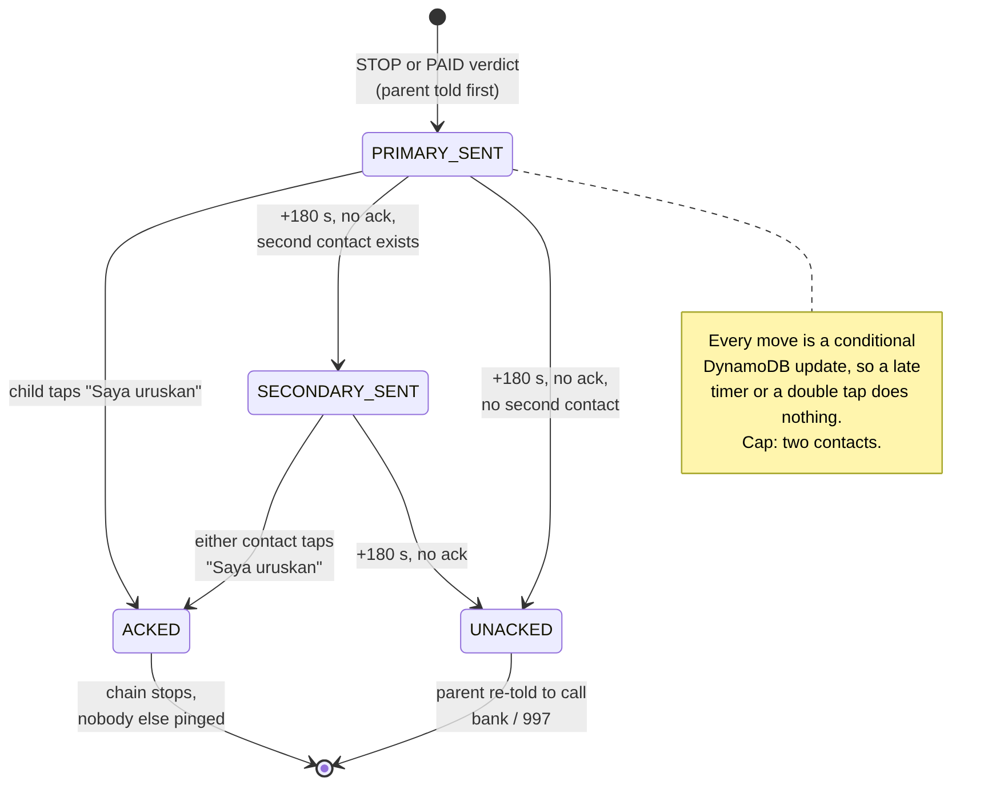
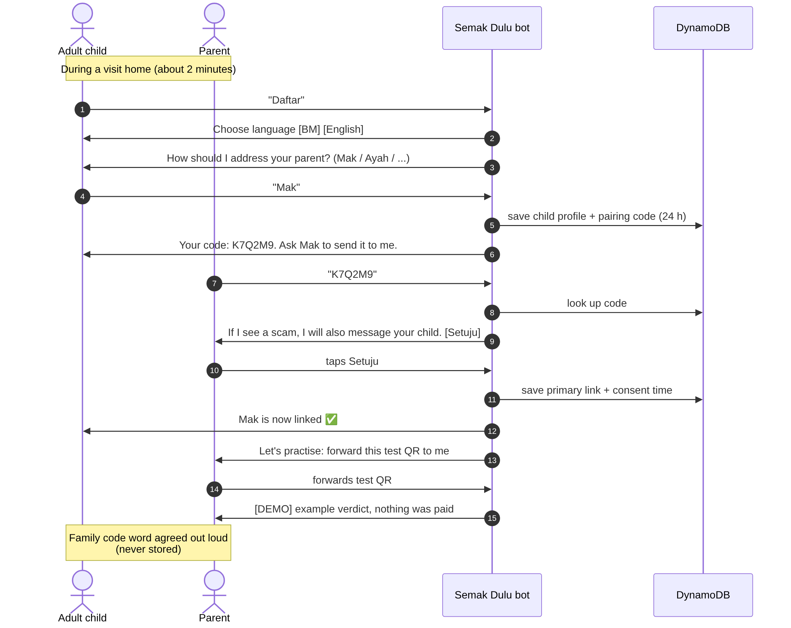
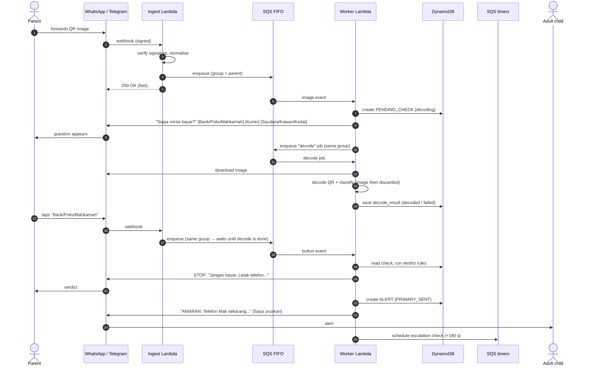
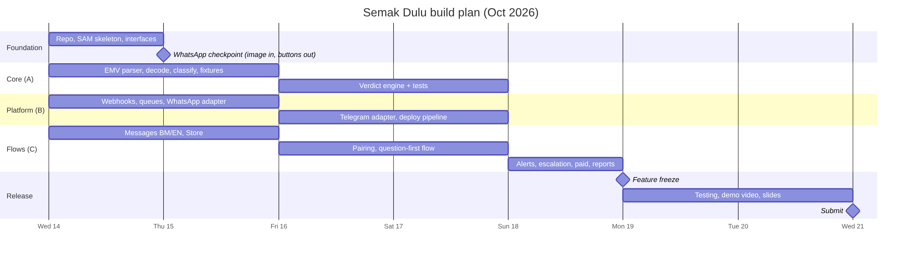

# Semak Dulu: Software Design Document

| | |
|---|---|
| **Product** | Semak Dulu ("Check First"), a WhatsApp bot that checks payment QR codes for seniors |
| **Track** | Cybersecurity: scam prevention for vulnerable Malaysians |
| **Version** | 1.0 (draft), 14 Oct 2026 |
| **Status** | Ready for team review |
| **Related document** | Software Requirements Specification (SRS) v1.0: FR-01 to FR-27, DR-01 to DR-09, NFR-xx-nn |
| **Template** | Follows Atlassian's software design document structure (sections 1 to 8), plus extra sections the build needs (sections 9 to 17) |

**How to read the tags in this document**

| Tag | Meaning |
|---|---|
| `[VERIFY]` | Based on memory or a small test. Check it against official docs or more tests before relying on it. |
| `[OPEN]` | A decision the team still has to make. |
| `[PROPOSED]` | A recommendation. Change it if the team disagrees. |

All diagrams are in the `diagrams/` folder. Each has an editable Mermaid source (`.mmd`) and a rendered image (`.png`) for slides.

---

## Contents

1. [Introduction and overview](#1-introduction-and-overview)
2. [System architecture](#2-system-architecture)
3. [Data design](#3-data-design)
4. [Interface design](#4-interface-design)
5. [Component design](#5-component-design)
6. [User interface design](#6-user-interface-design)
7. [Assumptions and dependencies](#7-assumptions-and-dependencies)
8. [Glossary of terms](#8-glossary-of-terms)
9. [Security and privacy](#9-security-and-privacy)
10. [Reliability and error handling](#10-reliability-and-error-handling)
11. [Testing strategy](#11-testing-strategy)
12. [Deployment, environments and monitoring](#12-deployment-environments-and-monitoring)
13. [Team and build plan](#13-team-and-build-plan)
14. [Requirements traceability](#14-requirements-traceability)
15. [Risks and open items](#15-risks-and-open-items)
16. [Decisions log](#16-decisions-log)
17. [Future work](#17-future-work)

---

## 1. Introduction and overview

### 1.1 Purpose of this document

This document explains **how** Semak Dulu will be built. It turns the requirements in the SRS into a design that the team can split up and build in parallel, starting 14 Oct 2026, with the feature freeze on 19 Oct and submission on 21 Oct.

### 1.2 Audience

| Reader | What they need from this document |
|---|---|
| Developers (team of 3 to 4) | Which module they own, the interfaces between modules, and the rules the code must follow |
| Testers and demo owner | The scenarios to test and demo (section 11) |
| Hackathon judges | The architecture, the reasons behind it, and how it handles risk |

### 1.3 Background

Malaysians lost about RM2.7 billion to cybercrime in 2025 (figure from the hackathon brief). Seniors aged 50 and over are among the most targeted. A common scam works like this:

1. A caller pretends to be someone trusted: a bank officer, a police or court officer, a courier, or an old friend or relative.
2. They create urgency ("we sent you money by mistake", "your account will be frozen").
3. They send a QR code and ask the senior to pay.

The senior believes the caller, so generic warnings like "don't send money to strangers" don't apply in their mind.

### 1.4 Product summary

The parent forwards the suspicious QR image to the Semak Dulu bot on WhatsApp. The bot asks one question: **"Who asked you to pay?"** It then replies with one of two verdicts:

- 🛑 **STOP**: "Don't pay." The bot also alerts the adult child who set it up.
- 🟡 **VERIFY**: "Not sure. Don't pay yet. Do this one thing first" (for example, call the person back on a number you already saved).

**The bot never says a QR is "safe".** No check can prove that, and a false "safe" is the most dangerous thing a safety tool can say.

### 1.5 Goals and non-goals

| Goals (in the MVP) | Non-goals (not in the MVP) |
|---|---|
| Check a forwarded payment QR in a few taps, with nothing to install | Voice-clone detection (roadmap: may raise urgency, never lower it) |
| Catch the trusted-caller scam with a simple, explainable rule | Phishing URL scanning (first roadmap item) |
| Alert a family member quickly on a STOP | Deepfake image or video detection |
| Let users report scam QRs, with protection against false reports | MCMC or Semak Mule database integration |
| Work in Bahasa Melayu (default) and English | Languages other than BM and English |
| Run on WhatsApp, with Telegram as a fallback | A web or mobile app |

### 1.6 Key requirements (summary)

The full list is in the SRS. The design must satisfy these most of all:

| Area | Requirement IDs | In one line |
|---|---|---|
| Setup | FR-01 to FR-04 | The child sets up the bot for the parent, with consent and a language choice |
| QR check | FR-05 to FR-13 | Forward a QR, answer one question, get STOP or VERIFY with one action, never "safe" |
| Reports | FR-14 to FR-17 | Report a QR by tapping a reason. Reports add wording but never cause a STOP |
| Alerts | FR-18 to FR-20 | On STOP, alert the child, escalate to a second contact after about 3 minutes |

### 1.7 Design principles

These rules guide every decision below. If a design choice breaks one, the choice is wrong.

1. **Never say "safe".** The code has only two verdict values, `STOP` and `VERIFY`. There is no `SAFE` value, so no bug can produce one.
2. **Ask first, decode in the background.** The question goes out as soon as the image arrives. The most important STOP (bank, police or court) doesn't need the QR at all.
3. **Fixed rules decide, not AI.** The verdict comes from simple rules, not a language model. The same input always gives the same answer, and each answer can be explained in one sentence.
4. **The core logic doesn't know about WhatsApp.** One Python package holds all the logic. WhatsApp and Telegram are thin adapters, so switching channels is easy.
5. **Every message ends with an action** the parent can finish in under a minute.
6. **Keep as little data as possible.** The image is never saved. Reports store scrambled (hashed) keys, not names or account numbers.

---

## 2. System architecture

### 2.1 System context

This shows who uses the system and what it connects to.



### 2.2 Architecture overview



**How a message moves through the system, in plain words:**

1. WhatsApp (or Telegram) sends the parent's message to our web address (**API Gateway**).
2. A small function (**Ingest Lambda**) checks the message is genuine, puts it in a queue, and replies "OK" straight away. WhatsApp expects a fast reply and resends the message if it doesn't get one.
3. The queue (**SQS FIFO**) keeps each user's messages in order.
4. The main function (**Worker Lambda**) does the real work: sends the question, then puts a "decode" job on the same FIFO queue, decodes the QR in that job, applies the rules when the parent taps, and sends the verdict and alerts (D-17).
5. **DynamoDB** stores users, links between parent and child, pending checks, alerts and reports.
6. A second queue (**SQS timers**) holds delayed jobs, such as "check in 3 minutes whether the child replied".

### 2.3 Components

| Component | What it does | Why it exists |
|---|---|---|
| API Gateway (HTTP API) | Public web address for webhooks (`/wa`, `/tg`) | WhatsApp and Telegram need a URL to send messages to |
| Ingest Lambda | Checks the signature, converts the message to one standard format, puts it in the queue | Replies to WhatsApp in milliseconds, so slow work never causes resends |
| SQS FIFO queue | Holds incoming events, in order, grouped by user | Stops two events for the same user being processed at once |
| SQS standard queue (timers) | Holds delayed jobs (reminder at 2 min, escalation at 3 min) | FIFO queues can't delay single messages, standard queues can (up to 15 min) |
| Dead-letter queue | Collects events that failed 3 times | Nothing is lost silently, and the team can inspect failures |
| Worker Lambda (zip + layer) | Runs the core logic and QR decoding, sends replies | QR libraries (zxing-cpp, Pillow) come from a Lambda layer of ready-made Linux wheels, so no Docker is needed (D-16) |
| DynamoDB (single table) | Stores all data, with automatic expiry (TTL) | Pay per use, no servers, and expiry handles privacy cleanup |
| SSM Parameter Store | Holds secrets (tokens, app secret, report pepper) | Keeps secrets out of the code |
| CloudWatch | Logs and alarms | Lets the team see errors during the demo week |

### 2.4 Design patterns and why we chose them

| Pattern | Where | Why |
|---|---|---|
| **Queue-based processing** | Ingest → SQS → Worker | WhatsApp needs a fast "OK". Decoding an image can take a second or two. The queue separates the two. |
| **Per-user ordering** | FIFO `MessageGroupId = user_id` | The parent's tap is always processed after their image has been decoded. No locks or waiting code needed. |
| **Ports and adapters** | `core/` vs `channels/` | The logic is tested without any network. WhatsApp can be swapped for Telegram with no logic changes. |
| **State machine** | Child alert escalation | The alert's progress (sent, escalated, handled) is clear, testable, and safe against late or double events. |
| **Single-table DynamoDB** | All data | One table to deploy and manage, and access patterns are simple key lookups. |
| **Idempotent handlers** | Every event and timer | WhatsApp may send the same message twice. Each event is processed once only. |

### 2.5 Alternatives we considered

| Option | Why we didn't choose it |
|---|---|
| Web app or mobile app | Too many steps for a senior (open browser, find the site, upload, choose file). WhatsApp needs only "forward". |
| One Lambda that does everything synchronously | A slow decode could make WhatsApp time out and resend, causing duplicate replies. |
| An AI model (LLM) decides the verdict | Answers can vary, are hard to explain, and could produce a "safe"-sounding reply. Fixed rules are safer here. |
| Decode first, then ask the question | A failed decode (blurry photo) would block the STOP for the most important case. Asking first removes that risk. |
| A relational database (RDS) | Needs a running server and more setup. Our data fits key lookups well. |
| Telegram only | Malaysian seniors use WhatsApp far more. Telegram stays as the fallback and possible judge-testing channel. |

### 2.6 Performance targets

These are targets to measure during testing, not guarantees.

| Step | Target |
|---|---|
| Parent forwards image → question appears | Under 3 seconds |
| Parent taps answer → verdict appears | Under 3 seconds (includes decode time, see trade-off below) |
| STOP verdict → child receives alert | Under 3 seconds after the verdict |

**Trade-off:** because one user's events are processed in order, the verdict waits until the decode for that image has finished, even for a bank/police/court STOP that doesn't need it. Decoding should take 1 to 2 seconds, so this delay is small, and in return we get simple, race-free code. If testing shows decode is slow, the decode can move to a separate step.

### 2.7 Technology stack

| Layer | Choice | Notes |
|---|---|---|
| Language | Python 3.12 | The team's strongest language |
| Compute | AWS Lambda | Both functions are zip packages. QR libraries are in one Lambda layer built by `scripts/build_layer.sh` (D-16). |
| API | API Gateway HTTP API | Routes: `GET /wa` (WhatsApp verification), `POST /wa`, `POST /tg` |
| Queues | Amazon SQS | FIFO for events, standard for timers, plus a dead-letter queue |
| Database | Amazon DynamoDB | On-demand billing, TTL enabled |
| QR decoding | `zxing-cpp` + Pillow (image clean-up and retry). OpenCV removed (D-16). | Tested 14 Oct: layer 33 MB, decodes on Python 3.12 x86_64 |
| Channels | WhatsApp Cloud API (target), Telegram Bot API (fallback) | |
| Secrets | AWS SSM Parameter Store (SecureString) | |
| Infrastructure as code | AWS SAM | One `template.yaml`, deploy with `sam build && sam deploy` |
| Testing | pytest, moto (fake AWS), a fake channel | |
| Region | Asia Pacific (Malaysia) if available to the account, otherwise Singapore | `[VERIFY]` region availability for all services used |

---

## 3. Data design

### 3.1 Data model

All data lives in **one DynamoDB table**. Each item has a partition key (`PK`) and a sort key (`SK`). The diagram shows the item types and how they relate.



### 3.2 Item types

| Item | PK | SK | Main fields | Deleted after |
|---|---|---|---|---|
| User | `USER#<channel>#<id>` | `PROFILE` | `role` (parent, child, second), `lang` (ms, en), `address_as` ("Mak", "Ayah"), `consent_at` | Never (until the user sends "Berhenti") |
| Link | `USER#<parent>` | `LINK#PRIMARY` or `LINK#SECONDARY` | `contact_id`, `status`, `consent_at` | Never (until unlinked) |
| Pairing code | `PAIR#<code>` | `PAIR` | `owner_id`, `target_role`, `address_as` | 24 hours |
| Pending check | `USER#<parent>` | `CHECK#<ulid>` | `status` (decoding, decoded, failed, answered), `claim`, `decode_result` | 15 minutes |
| Alert | `ALERT#<check_id>` | `STATE` | `type` (STOP, PAID), `stage`, `acked_by`, timestamps | 7 days |
| Report | `REPORT#<report_key>` | `REP#<reporter_hash>` | `reason`, `category`, `created_at` | Kept (no personal data inside) |
| Dedupe marker | `DEDUP#<msg_id>` | `-` | none | 24 hours |

**Index:** one global secondary index (`GSI1`) on Link items (`GSI1PK = USER#<contact>`) so the bot can find "which parent is this child linked to?" when the child taps "Saya uruskan".

### 3.3 How the code reads and writes data (access patterns)

| Need | How |
|---|---|
| Load a user's profile | Get `USER#…` / `PROFILE` |
| Find the parent's contacts | Query `USER#<parent>`, SK begins with `LINK#` |
| Find the parent of a child | Query `GSI1` with `USER#<child>` |
| Find the latest pending check | Query `USER#<parent>`, SK begins with `CHECK#`, newest first, limit 1 |
| Count distinct scam reports for a QR | Query `REPORT#<report_key>`, count items with `category = scam_pattern` |
| Stop a duplicate report | Conditional put: only if `REP#<reporter_hash>` doesn't exist |
| Move an alert to its next stage | Conditional update: only if `stage` is still the expected value |
| Skip a duplicate event | Conditional put of `DEDUP#<msg_id>`, skip if it already exists |

### 3.4 The decode result

Every decode produces one `DecodeResult`, which the verdict engine and messages use.

```python
@dataclass
class DecodeResult:
    kind: str              # payment_duitnow | payment_other_emv | url | other_text | no_qr | unreadable
    static_dynamic: str    # static (tag 01 = 11) | dynamic (tag 01 = 12) | unknown
    is_personal: bool | None   # True = MCC 0000, False = real MCC, None = can't tell
    mcc: str | None        # tag 52
    payee_name: str | None # tag 59, shown to the parent, kept only in the pending check
    amount: str | None     # tag 54, dynamic QRs only
    network_id: str | None # tag 26, sub-field 00 (DuitNow = A0000006150001)
    crc_ok: bool | None    # checksum result, never used to soften a verdict
    report_key: str | None # set for static DuitNow QRs only
```

### 3.5 What we learned from real QR samples

The team decoded 5 real QR codes (3 different personal QRs from bank apps, 1 business static, 1 business dynamic) and 1 e-wallet customer code. These findings shape the design:

| Finding | Design decision |
|---|---|
| Tag 01 is `11` on static (reusable) QRs and `12` on the dynamic QR that had an amount | Use tag 01 for static/dynamic. Show an amount only when tag 54 exists. |
| All 3 personal QRs have merchant category code (MCC) `0000`. Both business QRs have real codes (`7311`, `4722`). | `is_personal = True` only for a DuitNow QR with MCC `0000`. |
| Tag 26 sub-field `00` is `A0000006150001` in every sample | Use it to recognise DuitNow QRs `[VERIFY]` against PayNet's specification. |
| Tag 26 sub-field `01` (6 digits) looks like a bank code, sub-field `02` like an account or merchant reference | Build the report key from these `[VERIFY]` meaning. |
| Sub-field `03` and tag 62 appear only in some samples, and may identify a person | Left out of the report key and never stored. |
| The dynamic QR's sub-field `02` is a one-time bill reference | No report key for dynamic QRs. |
| Every sample has a valid checksum | A scammer's QR has a valid checksum too, so it never makes a verdict softer. |
| E-wallet "pay at cashier" codes (Setel, Grab) are short strings, not payee QRs | They become `other_text` and get a plain message, never technical text. |

**Not yet tested:** an e-wallet **receive-money** QR (Touch 'n Go, GrabPay, Boost). Until it is tested, any unfamiliar pattern gets VERIFY.

### 3.6 Data retention and privacy

| Data | Stored? | How long | Why |
|---|---|---|---|
| QR image | **No.** Held in memory only, then discarded | Seconds | Not needed after decoding |
| Payee name, amount | Inside the pending check only | 15 minutes | Shown in the verdict |
| Raw account numbers | **No** | n/a | Only a scrambled report key is kept |
| Report key | Yes | Kept | Needed to count reports. It is an HMAC (a keyed hash), so it can't be reversed without the secret pepper. |
| Phone numbers | Yes, in user and link items | Until the user sends "Berhenti" | Needed to send messages and alerts |
| Family code word | **Never** | n/a | Agreed out loud during setup |
| Logs | No names, payloads or numbers | CloudWatch default retention, set to 14 days | Debugging only |

### 3.7 Data validation rules

- Reject images larger than a set limit (for example 5 MB) before decoding `[PROPOSED]`.
- The TLV parser rejects tags or lengths that aren't digits, or lengths that go past the end of the payload.
- Pairing codes: 6 characters from an alphabet without look-alike characters (no `0/O`, `1/I`), single use, 24-hour expiry.
- Button IDs are checked against the expected format and the user's current state. A button for an old or expired check gets a polite "this check has expired, please forward the QR again".
- DynamoDB's automatic deletion can be late, so the code also checks `expires_at` on every read.

---

## 4. Interface design

### 4.1 External interfaces

| Interface | Direction | What we use | Notes |
|---|---|---|---|
| WhatsApp Cloud API | In (webhook) | Text, image and button-reply events | Signed with `X-Hub-Signature-256` `[VERIFY]` |
| WhatsApp Cloud API | Out | Send text, send reply buttons (max 3) `[VERIFY]`, download media | Media download is two steps: get URL, then download with token `[VERIFY]` |
| Telegram Bot API | In (webhook) | Messages, photos, callback queries | Checked with the secret-token header |
| Telegram Bot API | Out | `sendMessage` with inline keyboard, `getFile` | No 24-hour messaging rule |
| AWS SSM | Out | Read secrets at cold start | Cached in memory |

### 4.2 Internal interfaces

These are fixed on day 1 so each person can build against them in parallel.

```python
@dataclass
class InboundEvent:
    channel: str             # "wa" or "tg"
    user_id: str             # phone number (wa) or chat id (tg)
    msg_id: str              # used to skip duplicates
    kind: str                # "text" | "image" | "button"
    text: str | None
    media_ref: str | None    # WhatsApp media id or Telegram file_id
    button_id: str | None    # see 4.3
    ts: int

@dataclass
class Button:
    id: str
    label: str               # max 20 characters for WhatsApp [VERIFY]

@dataclass
class Outbound:
    to: str
    text: str
    buttons: list[Button] | None = None
    delay_s: int | None = None   # set = this is a timer job, not a message

class Channel(Protocol):
    def verify(self, headers: dict, body: bytes) -> bool: ...
    def parse(self, body: bytes) -> list[InboundEvent]: ...
    def send(self, msg: Outbound) -> None: ...
    def fetch_media(self, media_ref: str) -> bytes: ...

class Store(Protocol):      # DynamoDB in production, in-memory in tests
    ...

def handle_event(event: InboundEvent, store: Store, deps: Deps) -> list[Outbound]: ...
```

The worker calls `handle_event`, sends each returned message, and puts each timer on the timers queue. The core never calls the network itself.

### 4.3 Button ID format

`<action>:<value>:<check_or_alert_id>`

| Example | Meaning |
|---|---|
| `claim:OFFICIAL:01JA…` | Parent says a bank, police or court asked |
| `claim:COURIER:01JA…` | Parent says a courier asked |
| `claim:KNOWN_PERSON:01JA…` | Parent says a relative, friend or seller asked |
| `paid:yes:01JA…` | Parent says they already paid |
| `report:open:01JA…` / `report:SCAM:01JA…` | Report flow |
| `ack:handle:<alert_id>` | Child or second contact taps "Saya uruskan" |
| `consent:yes:<pair_code>` | Parent agrees to alerts during setup |
| `lang:ms` / `lang:en` | Language choice |

### 4.4 Error handling at the interfaces

| Problem | What the system does |
|---|---|
| Webhook signature is wrong | Ingest returns 401 and nothing is queued |
| Same message arrives twice | Second copy is skipped (FIFO dedupe and the dedupe marker) |
| Media download fails | Retry once, then tell the parent "we couldn't open the picture, please send it again" |
| Sending a reply fails | The worker raises an error, SQS retries the event, and after 3 failures it goes to the dead-letter queue |
| Child alert can't be delivered (for example, outside WhatsApp's 24-hour window) | The parent's STOP has already been sent. The failure is logged and the escalation timer still runs. |
| Unknown text from a user | A short help message with the main action: "Forward the QR picture to me" |

---

## 5. Component design

### 5.1 Module overview

| Module | Purpose | Input | Output | Depends on |
|---|---|---|---|---|
| `core/emv.py` | Parse EMV tag-length-value data, check the checksum, parse nested tag 26 | Payload string | List of fields, error | None |
| `core/decode.py` | Turn an image into a QR payload string | Image bytes | String or None | Pillow, zxing-cpp |
| `core/classify.py` | Decide what kind of QR it is and extract fields | Payload string | `DecodeResult` | `emv.py` |
| `core/verdict.py` | Apply the verdict rules | Claim, `DecodeResult`, report count | `Verdict` | None |
| `core/reports.py` | Build the report key, store reports, count evidence | `DecodeResult`, reporter, reason | Evidence level | `store.py` |
| `core/escalation.py` | Alert state machine | Alert event or timer | Next stage, messages | `store.py` |
| `core/flows.py` | Main entry point: setup, check, tap, ack, paid, report | `InboundEvent` | `list[Outbound]` | All of the above |
| `core/messages.py` | Load message text, fill in variables | Message ID, language, values | Text | `messages/*.yaml` |
| `core/store.py` | Read and write data | Domain objects | Domain objects | boto3 (production) |
| `channels/whatsapp.py`, `telegram.py` | Talk to each messaging platform | HTTP | `InboundEvent`, sends | requests or httpx |
| `handlers/ingest.py` | Lambda: verify and queue | API Gateway event | SQS message | channels |
| `handlers/worker.py` | Lambda: process and send | SQS message | Messages and timers | core, channels |

### 5.2 QR decoding pipeline (`decode.py`, `classify.py`)



**Steps:**

1. Check the image is a real image and not too large.
2. Clean it up with Pillow: fix rotation from phone photos, convert to grayscale, shrink very large images.
3. Try `zxing-cpp`. If it finds nothing, try once more on an enlarged (x2), higher-contrast copy. (OpenCV was dropped, D-16: in tests zxing-cpp alone read 3 to 4 px/module JPEG screenshots, 12° rotation and low-contrast images.)
4. Classify the text: a web link, a DuitNow payment QR, another payment QR, or other text.
5. For DuitNow QRs, read the fields and decide `is_personal` and `report_key`.
6. Discard the image.

**Starting point:** the team's Colab notebook already has a working TLV parser and checksum check. Two fixes before reuse: swap the tag 01 labels (`11` = static, `12` = dynamic), and return data instead of printing. The missing `inspect_url` function isn't needed in the MVP, since URL QRs just get a fixed warning.

### 5.3 Verdict engine (`verdict.py`)



```python
class Level(Enum):
    STOP = "stop"
    VERIFY = "verify"        # there is deliberately no SAFE

@dataclass
class Verdict:
    level: Level
    reason_code: str         # e.g. "R1_official"
    message_id: str          # e.g. "v.stop.official"
    params: dict             # payee_name, amount, address_as...
    notify_child: bool       # True only when level is STOP
```

**Rules (the first match wins):**

| Rule | When | Verdict | Message idea |
|---|---|---|---|
| R1 | Claim is bank, police or court | 🛑 STOP | "Banks, police and courts never ask you to pay by QR. Don't pay. Hang up." `[VERIFY]` cite a bank or PDRM advisory |
| R2 | Claim is courier, and the QR is a personal account | 🛑 STOP | "The caller says courier, but this account is in a personal name." |
| R3 | Claim is courier, and the QR couldn't be read | 🟡 VERIFY | "We couldn't read the QR. Don't pay yet." |
| R4 | Claim is courier, and the QR is a business or unknown | 🟡 VERIFY | Show the merchant name, check it with the courier's official app |
| R5 | Claim is relative, friend or seller | 🟡 VERIFY | Show the payee name. Call back on a saved number and ask the family code word. |

**Report wording (added to any verdict, never changes the level):**

| Distinct scam reports for this QR | Extra line |
|---|---|
| 0 | "No reports found, but that doesn't mean it is safe." |
| 1 to 2 | "This account has 1 (or 2) unconfirmed reports. Be careful." |
| 3 or more `[PROPOSED]` | "Several people have reported this account." Never "penipu" (scammer). |

Every verdict also offers two buttons: **"Saya sudah bayar"** (I already paid) and **"Laporkan QR ini"** (report this QR).

### 5.4 Child alert and escalation (`escalation.py`)



**How it works:**

1. On a STOP, the parent is told first: "Jangan bayar. Letak telefon. {child} akan telefon sebentar lagi."
2. The primary contact gets the alert, with a **"Saya uruskan"** (I'm handling it) button.
3. A timer is set for 180 seconds.
4. If nobody has tapped by then and a second contact exists, the second contact gets the alert. Another timer is set.
5. If still nobody taps, the parent is reminded to call their bank and 997.
6. As soon as anyone taps "Saya uruskan", the chain stops. The cap is two contacts.

Every stage change is a **conditional update** in DynamoDB ("only move to SECONDARY_SENT if the stage is still PRIMARY_SENT"), so a late timer or a double tap does nothing.

**Alert types:**

| Type | Trigger | Content |
|---|---|---|
| STOP (QR decoded) | R1 or R2 with a readable QR | Who the caller claimed to be, that the account is personal (if known), that we don't know if money was sent, ask the code word |
| STOP (QR unreadable) | R1 with a failed decode | Same, but says the QR couldn't be read |
| PAID | Parent taps "Saya sudah bayar" | Urgent: call the parent now, help them call the bank and 997 |

### 5.5 Reports (`reports.py`)

1. After a verdict, the user can tap "Laporkan QR ini".
2. The bot shows 3 reasons:
   - "Pemanggil menyamar sebagai bank, polis, mahkamah atau kurier" (scam pattern: **counts**)
   - "Penjual atau orang itu tidak jujur" (dispute: stored, **doesn't count**)
   - "Lain-lain" (other: stored, **doesn't count**)
3. Only static DuitNow QRs can be reported (they have a stable report key). For others, the bot explains it can't add this one.
4. One report per phone number per QR, enforced by a conditional write.
5. **Report key** = `HMAC-SHA256(pepper, network_id | sub01 | sub02)`. The pepper is a secret in SSM, so the key can't be turned back into an account number.

**Limit to state honestly in the pitch:** someone with many phone numbers can still add fake reports. That's why reports only add wording and never cause a STOP.

### 5.6 Pending checks and timeouts (`flows.py`)

- When an image arrives, a pending check is created and the question is sent.
- If the parent forwards a new image before answering, the new check replaces the old one.
- **If the parent doesn't tap within about 2 minutes**, the bot sends a reminder: "Jangan bayar dahulu. Pilih siapa yang minta bayaran." with the same buttons. A stalled parent may be on the phone with the scammer, so the reminder leads with "don't pay".
- After 10 minutes with no answer, the check is closed. A later tap gets "this check has expired, please forward the QR again".

---

## 6. User interface design

The "screens" of this product are WhatsApp messages. The design goal is that a 65-year-old with low digital literacy can complete a check without help.

### 6.1 Setup flow (done once, by the child, during a visit)



**What the child forwards to the parent to start (BM, edit to suit the family):**

> Mak, ini nombor yang saya simpan untuk Mak. Kalau ada orang call suruh Mak bayar duit atau bagi kod QR, forward gambar tu ke sini dulu. Dia akan beritahu Mak boleh bayar ke tak. Kita cuba sekali sekarang ya.

The child also saves the bot as a contact (for example "Semak Dulu"), pins the chat, and agrees a family code word with the parent.

### 6.2 Check flow (the core experience)



### 6.3 Message mock-ups

**Step 1: The question** (sent within seconds of forwarding)

```
┌──────────────────────────────────────┐
│ Terima kasih. Sebelum bayar:          │
│ Siapa yang minta Mak bayar?           │
│                                       │
│ [ Bank/Polis/Mahkamah ]               │
│ [ Kurier ]                            │
│ [ Saudara/Kawan/Kedai ]               │
└──────────────────────────────────────┘
```

**Step 2a: STOP verdict (rule R1)**

```
┌──────────────────────────────────────┐
│ 🛑 JANGAN BAYAR.                       │
│ Bank, polis dan mahkamah tidak akan   │
│ minta bayaran melalui kod QR.         │
│ Letak telefon sekarang. Saya sudah    │
│ maklumkan anak Mak.                   │
│                                       │
│ [ Saya sudah bayar ] [ Laporkan QR ]  │
└──────────────────────────────────────┘
```

**Step 2b: VERIFY verdict (rule R5)**

```
┌──────────────────────────────────────┐
│ 🟡 Tunggu dulu.                        │
│ Nama pada QR: AHMAD BIN ...           │
│ Kami tidak jumpa laporan, tetapi itu  │
│ tidak bermakna ia selamat.            │
│ Jangan bayar dahulu. Telefon semula   │
│ orang itu guna nombor yang Mak sudah  │
│ simpan, dan tanya kod rahsia keluarga.│
│                                       │
│ [ Saya sudah bayar ] [ Laporkan QR ]  │
└──────────────────────────────────────┘
```

**Child alert (STOP, QR decoded)**

```
┌──────────────────────────────────────┐
│ ⚠️ AMARAN: Telefon Mak sekarang.       │
│ Mak baru hantar kod QR untuk disemak. │
│ Pemanggil mengaku dari "bank", tetapi │
│ akaun penerima ialah akaun peribadi.  │
│ Kami tidak tahu sama ada wang sudah   │
│ dihantar. Tanya kod rahsia keluarga.  │
│ Jika sudah bayar: hubungi bank dan    │
│ 997 serta-merta.                      │
│                                       │
│ [ Saya uruskan ]                      │
└──────────────────────────────────────┘
```

All BM text must be reviewed by a native speaker before the demo.

### 6.4 Message catalogue

All user-facing text lives in `messages/ms.yaml` and `messages/en.yaml`. Code never builds sentences itself.

| Group | Message IDs |
|---|---|
| Setup | `s.welcome`, `s.lang`, `s.ask_address`, `s.pair_code`, `s.consent`, `s.linked`, `s.practice`, `s.demo_verdict` |
| Question | `q.who_asked`, `q.reminder`, `q.expired` |
| Verdicts | `v.stop.official`, `v.stop.courier_personal`, `v.verify.courier`, `v.verify.unreadable`, `v.verify.known_person` |
| Decode problems | `e.no_qr`, `e.unreadable`, `e.url`, `e.unknown_scheme`, `e.not_image` |
| Reports | `r.choose_reason`, `r.thanks`, `r.not_reportable`, `r.already_reported`, `ev.none`, `ev.few`, `ev.many` |
| Alerts | `a.child.stop_decoded`, `a.child.stop_unreadable`, `a.child.paid`, `a.ack_done`, `a.parent.unacked` |
| Paid | `p.paid` (bank first, then 997, then 999 if in danger, then a police report) |
| Help | `h.help`, `h.stop_confirm` |

### 6.5 Accessibility rules for seniors

| Rule | How we apply it |
|---|---|
| Action first | The first line of every verdict says what to do ("JANGAN BAYAR", "Tunggu dulu"). |
| Short messages | At most 10 lines and 700 characters (SRS NFR-UI-03). One idea per line. |
| Tap, don't type | Every answer is a button. Typing is only needed for the pairing code. |
| Familiar language | BM by default, everyday words, no "QR payload", "merchant" or "verify". |
| Address them personally | Uses the name the child chose ("Mak", "Ayah"). |
| Colour is not the only signal | Icons (🛑 🟡) always come with words, for colour-blind users. |
| No technical errors | Parser or network errors never reach users. Each case has a plain message. |
| Never "safe" | Enforced by a test that scans every message (see 11.1). |
| Practice run | The setup includes one practice check, so the first real use isn't the first use. |

---

## 7. Assumptions and dependencies

### 7.1 Assumptions

| # | Assumption | If it's wrong |
|---|---|---|
| A1 | Banks, police and courts never ask people to pay by QR over a call `[VERIFY]` | R1 needs rewording. Find an official advisory to cite. |
| A2 | MCC `0000` means a personal DuitNow account (true for 3 of 3 bank-app samples) | Courier STOP could misfire. Only R2 uses it, and unknowns fall to VERIFY. |
| A3 | `A0000006150001` identifies DuitNow `[VERIFY]` | DuitNow detection needs a different check. |
| A4 | WhatsApp reply buttons are limited to 3 `[VERIFY]` | If more are allowed, nothing breaks. We designed for 3. |
| A5 | The Meta test number can message a small set of registered phones `[VERIFY]` | Telegram becomes the main demo channel. |
| A6 | Bot-started WhatsApp messages need the user to have messaged in the last 24 hours, or a template `[VERIFY]` | Child alert may not deliver. Stage the demo inside the window. |
| A7 | 997 is the National Scam Response Centre number `[VERIFY]` hours and scope | Change the paid message. |
| A8 | The parent will forward the QR (helped by the setup visit and practice run) | Admitted limit: the bot can't help a parent who never forwards. |

### 7.2 External services and libraries

| Dependency | Used for | Risk |
|---|---|---|
| WhatsApp Cloud API (Meta) | Main channel | Approval and test limits (risks 2 to 4) |
| Telegram Bot API | Fallback channel | Low |
| AWS Lambda, API Gateway, SQS, DynamoDB, SSM, CloudWatch | Hosting | Low |
| `zxing-cpp` | QR decoding | Packaging on Lambda `[VERIFY]` |
| `Pillow` | Image clean-up | Low |
| `boto3`, `httpx` (or `requests`), `PyYAML`, `python-ulid` | AWS access, HTTP, messages, IDs | Low |
| `pytest`, `moto` | Testing | Low |

### 7.3 Constraints

- **Time:** build from 14 Oct, feature freeze 19 Oct, submit 21 Oct.
- **Team:** 3 to 4 people.
- **Cost:** expected to stay within AWS free-tier limits at hackathon volume `[VERIFY]`. WhatsApp test messages are free on the test number `[VERIFY]`.
- **Language:** BM required by the hackathon. English offered.

### 7.4 Compliance

- **Malaysia's Personal Data Protection Act (PDPA):** we store phone numbers and a parent-child link, so the bot shows a short privacy notice at setup (what is kept, why, and how to delete it with "Berhenti") `[VERIFY]` exact obligations.
- **Meta WhatsApp Business policies:** opt-in before messaging, no spam, templates for messages outside the 24-hour window `[VERIFY]`.
- **Consent:** the parent must tap "Setuju" before any alert can be sent about them.

---

## 8. Glossary of terms

| Term | Meaning |
|---|---|
| **Parent** | The senior who receives scam calls and forwards QR codes to the bot |
| **Child / primary contact** | The adult family member who sets up the bot and receives alerts |
| **Second contact** | An optional extra family member who is alerted if the child doesn't respond |
| **Claim** | The parent's answer to "Who asked you to pay?" |
| **STOP** | The firm verdict: don't pay. Triggers the child alert. |
| **VERIFY** | The cautious verdict: not sure, don't pay yet, do one check first |
| **Family code word** | A secret word the family agrees in person, used to confirm a caller's identity |
| **DuitNow QR** | Malaysia's national payment QR standard, run by PayNet |
| **EMV / EMVCo** | The international standard that payment QR codes follow |
| **TLV (tag-length-value)** | How a payment QR stores data: a 2-digit tag, a 2-digit length, then the value |
| **MCC (merchant category code)** | Tag 52. A 4-digit code for the type of business. `0000` appears on personal QRs. |
| **Static / dynamic QR** | Static = reusable, no amount (tag 01 = `11`). Dynamic = one payment, with an amount (tag 01 = `12`). |
| **CRC (checksum)** | Tag 63. Detects a damaged QR. It does **not** prove a QR is genuine. |
| **Report key** | A scrambled ID for a QR's account, used to count reports without storing the account number |
| **HMAC / pepper** | A way to scramble data with a secret key (the pepper), so it can't be reversed |
| **Webhook** | A web address that WhatsApp or Telegram calls when a new message arrives |
| **Lambda** | An AWS function that runs only when needed, with no server to manage |
| **SQS / FIFO** | Amazon's message queue. FIFO = first in, first out, in order. |
| **Dead-letter queue (DLQ)** | Where failed events go after several retries |
| **DynamoDB / TTL** | Amazon's database. TTL (time to live) deletes items automatically after a set time. |
| **SAM** | AWS Serverless Application Model, a tool to define and deploy the whole system from one file |
| **Idempotent** | Doing the same thing twice has the same effect as doing it once |
| **24-hour window** | WhatsApp's rule that a bot can freely message a user only within 24 hours of their last message |
| **Semak Mule** | PDRM's public website for checking if an account or phone number has been reported |
| **NSRC / 997** | National Scam Response Centre hotline `[VERIFY]` |

---

## 9. Security and privacy

*Extra section: not in the Atlassian template, but essential for a cybersecurity track.*

### 9.1 Threats and how we handle them

| Threat | What could happen | How we handle it |
|---|---|---|
| Fake webhook calls | Someone sends fake events to our URL | Every request's signature or secret token is checked before queueing |
| Fake reports | A rival or prankster reports an innocent seller | Only scam-pattern reasons count, one report per number per QR, wording scales slowly, and reports never cause a STOP |
| Leaked data | Database exposure reveals people's finances | No images, no raw account numbers, report keys are HMACs, pending data expires in 15 minutes |
| Leaked secrets | Tokens in code or logs | Secrets only in SSM, never logged. Each Lambda has its own minimal permissions. |
| Message flooding | Someone spams the bot to run up costs | API Gateway throttling. Per-user rate limit `[PROPOSED]` (for example 10 checks per 10 minutes). |
| Malicious QR content | A QR contains a harmful link | The bot never opens links found in QRs, it only warns |
| Malicious images | Very large or broken files crash the decoder | Size check first. Decoder errors are caught and become `unreadable`. |
| Pairing code abuse | Someone guesses a code and links to a stranger's parent | Codes are random, single use, expire in 24 hours, and the parent must tap "Setuju" |
| A scammer tells the parent to ignore the bot | The parent doesn't forward | Admitted limit. Mitigated by the setup habit and practice run. |

### 9.2 Privacy rules for the team

- Never commit real QR payloads, names or account numbers. Test fixtures use fake values with a recomputed checksum.
- Clear notebook outputs before committing (the current Colab notebook still shows a real name).
- Logs show only the first 4 characters of a hash for any user ID.
- The privacy notice explains what is kept and how "Berhenti" deletes the user's profile and links.

---

## 10. Reliability and error handling

*Extra section: covers what happens when things go wrong.*

| Mechanism | Detail |
|---|---|
| Duplicate protection | FIFO deduplication by message ID, plus a `DEDUP#` marker in DynamoDB |
| Retries | Delivery is **at-most-once** (D-18): the worker marks each message id as seen before acting, logs any failure as `worker.error` (CloudWatch alarm), and does not retry, so a senior never receives the same verdict twice. The dead-letter queues catch messages the worker cannot read at all. |
| Timeouts | Worker timeout 30 seconds. The queue's visibility timeout is longer (for example 60 seconds), so an event isn't picked up twice. |
| Safe timers | Every timer re-reads the current state before acting |
| Batch size | Worker processes 1 event at a time, so one bad event can't block others |

**What still works when something fails:**

| Failure | Result |
|---|---|
| QR can't be decoded | Bank/police/court STOP still works. Other claims get VERIFY with "couldn't read". |
| Child alert can't be sent | The parent already has their STOP message |
| Second contact not set up | The chain ends after the first contact, and the parent is reminded to call the bank |
| WhatsApp is blocked or approval fails | Same logic runs on Telegram |
| DynamoDB error | Event is retried, then goes to the dead-letter queue, and an alarm fires |

---

## 11. Testing strategy

*Extra section: how we prove it works before the demo.*

### 11.1 Unit tests

| Area | What to test |
|---|---|
| `emv.py` | Valid payloads, cut-off payloads, wrong lengths, nested tag 26, checksum pass and fail |
| `classify.py` | Every fixture gives the expected `kind`, `is_personal`, `static_dynamic` and `report_key` |
| `verdict.py` | Every rule R1 to R5, and that `Level` has no `SAFE` member |
| `reports.py` | Same QR always gives the same key, dynamic QRs give no key, duplicate reports are rejected |
| `escalation.py` | All state moves, late timers, double taps |
| Message catalogue | Every ID exists in both BM and EN, every variable is filled, and **no message claims safety** |

**Safety phrase test:** the test fails if any message contains words like "selamat", "safe", "boleh bayar" or "tiada masalah", **unless** the sentence is on a short allow-list of negated phrases such as "tidak bermakna ia selamat" / "doesn't mean it is safe".

### 11.2 Test fixtures

Made from the team's samples, with fake names and account digits and a recomputed checksum:

- 3 personal static DuitNow QRs
- 1 business static DuitNow QR
- 1 business dynamic DuitNow QR (with amount)
- 1 Setel-style customer code
- 1 URL QR, 1 blurry screenshot, 1 photo with no QR, 1 cut-off payload
- 1 e-wallet receive-money QR (still to collect)

### 11.3 End-to-end scenarios (also the demo script)

| # | Scenario | Expected result |
|---|---|---|
| S1 | Claim bank, personal QR | STOP, child alerted |
| S2 | Claim bank, blurry image | STOP (no decode needed), child alert says "couldn't read" |
| S3 | Claim courier, personal QR | STOP |
| S4 | Claim courier, business QR | VERIFY with merchant name |
| S5 | Claim relative, personal QR | VERIFY with payee name and code word |
| S6 | URL QR | Warning, link never opened |
| S7 | Parent doesn't tap | Reminder after about 2 minutes |
| S8 | Child doesn't tap "Saya uruskan" | Second contact alerted after about 3 minutes, then the chain stops |
| S9 | Parent taps "Saya sudah bayar" | Bank, 997 and 999 message, urgent child alert |
| S10 | Same webhook delivered twice | Only one reply |
| S11 | 3 different people report the same static QR | Stronger wording, verdict level unchanged |
| S12 | Report on a dynamic QR | Polite refusal, nothing stored |
| S13 | Tap on an expired check | "Please forward the QR again" |
| S14 | Parent sends "Berhenti" | Profile and links removed, confirmation sent |

### 11.4 User testing

Before 19 Oct, if possible, ask 2 or 3 people aged 50+ to try the practice run with no help. Note where they hesitate. This is strong evidence for the Usability score.

---

## 12. Deployment, environments and monitoring

*Extra section: how the system gets to AWS and stays healthy.*

| Topic | Plan |
|---|---|
| Tooling | AWS SAM. `sam build && sam deploy --config-env dev` (or `prod`). |
| Environments | `dev` (each developer can deploy) and `prod` (the demo stack, deployed only from `main`) |
| Configuration | Environment variables for table and queue names. Secrets in SSM: `/semak/{env}/wa_token`, `wa_app_secret`, `wa_verify_token`, `tg_token`, `tg_secret`, `report_pepper`. |
| Local testing | Core logic runs with pytest and an in-memory store, no AWS needed. `sam local invoke` for handlers. |
| Rollback | Redeploy the previous Git tag. Tag each demo-ready build (`demo-1`, `demo-2`...). |
| Alarms | Dead-letter queue has any message, worker error rate above a threshold, worker duration close to timeout |
| Demo safety | Record a backup demo video the day before. Keep a list of the pre-registered test phone numbers. |

---

## 13. Team and build plan

### 13.1 Ownership

| Owner | Area | Modules |
|---|---|---|
| **A** | Core engine | `emv.py`, `decode.py`, `classify.py`, `verdict.py`, fixtures, their tests |
| **B** | Platform and channels | `template.yaml`, handlers, `whatsapp.py`, `telegram.py`, queues, secrets, deployment |
| **C** | Flows and content | `flows.py`, `escalation.py`, `reports.py`, `store.py`, `messages/*.yaml` |
| **D** (if 4 people) | Quality, demo and pitch | End-to-end tests, demo script and video, slides, keeping SRS and SDD up to date |

With 3 people, A also takes the tests, C takes the demo script, and B takes the demo video.

### 13.2 Repository layout

```
semak-dulu/
├── template.yaml               # SAM: API, Lambdas, queues, table, permissions
├── src/
│   ├── core/                   # pure logic, no network calls
│   │   ├── emv.py  decode.py  classify.py  verdict.py
│   │   ├── flows.py  escalation.py  reports.py
│   │   └── messages.py  store.py
│   ├── channels/               # base.py, whatsapp.py, telegram.py
│   └── handlers/               # ingest.py, worker.py
├── messages/                   # ms.yaml, en.yaml
├── tests/
│   ├── fixtures/               # fake QR payloads, checksum recomputed
│   ├── test_emv.py  test_verdict.py  test_flows.py  test_messages.py
│   └── e2e/
└── docs/                       # SRS.md, SDD.md, diagrams/, demo-script.md
```

### 13.3 Timeline



| When | Goal |
|---|---|
| **Wed 14 Oct** | Repo, SAM skeleton deployed, interfaces from section 4.2 committed. Everyone starts on their module against stubs. |
| **Thu 15 Oct (end of day)** | **WhatsApp checkpoint:** receive a forwarded image, download it, reply with buttons. If this fails, Telegram becomes the main channel from Friday morning. |
| Fri 16 to Sat 17 Oct | Verdict engine, pending checks, question-first flow, pairing and consent. Scenarios S1 to S3 work end to end. |
| Sun 18 Oct | Alerts, escalation, paid flow, reports |
| **Mon 19 Oct** | **Feature freeze.** No new features after this. |
| Mon 19 to Wed 21 Oct | Testing with real QRs, BM review, demo video, slides, README, submission |

---

## 14. Requirements traceability

*Links each SRS requirement to where it is designed and tested.*

| Requirement | Summary | Design section | Test |
|---|---|---|---|
| FR-01 | Child sets up the bot for the parent | 6.1 | Setup walkthrough |
| FR-02 | Consent for alerts (code word agreed offline) | 6.1, 7.4 | S1, consent unit test |
| FR-03 | Optional second contact | 5.4 | S8 |
| FR-04 | Language choice (BM default, English) | 6.4 | Catalogue parity test |
| FR-05 | Accept a forwarded image, nothing to install | 2.2, 6.2 | S1 |
| FR-06 | Classify: payment, URL, other, unreadable | 5.2 | Fixture tests |
| FR-07 | Extract payee name, type, amount, checksum | 3.4, 3.5 | Fixture tests |
| FR-08 | "Who asked you to pay?" buttons (3) | 6.3 | S1 to S5 |
| FR-09 | STOP rule, works without a report database | 5.3 (R1, R2) | S1 to S3 |
| FR-10 | Otherwise VERIFY, never "safe" | 1.7, 5.3 | No-SAFE test, safety phrase test |
| FR-11 | Action first, one concrete step | 6.3, 6.5 | Message review |
| FR-12 | Separate message for each failure case | 5.2, 6.4 | S2, S6, fixtures |
| FR-13 | Already paid: bank, 997, then 999, then police report | 5.4, 6.4 | S9 |
| FR-14 | Report a QR by tapping a reason | 5.5 | S11, S12 |
| FR-15 | Wording scales with evidence, never "penipu" | 5.3 | S11 |
| FR-16 | One report per number per QR, reports never cause STOP | 5.5 | S11, unit test |
| FR-17 | Semak Mule as a link only | 5.3 | Message review |
| FR-18 | Alert only on STOP, action first | 5.4 | S1, S2 |
| FR-19 | Parent told the child has been informed | 5.4 | S1 |
| FR-20 | Escalate after 180 s, one tap stops, cap two | 5.4 | S8 |
| FR-21 | Practice check during setup | 6.1 | Setup walkthrough |
| FR-22 | "Berhenti" deletes the user | 9.1, 9.2 | S14 |
| FR-23 | Help message for unknown text | 4.4 | Unit test |
| FR-24 | Reminder at 120 s, close at 10 min | 5.6 | S7 |
| FR-25 | Tap on expired check | 3.7, 5.6 | S13 |
| FR-26 | New image replaces open check | 5.6 | Unit test |
| FR-27 | Confirm "Saya uruskan" to the contact | 5.4 | S8 |

---

## 15. Risks and open items

| # | Item | Why it matters | Action | Owner |
|---|---|---|---|---|
| 1 | `[OPEN]` Must judges be able to try the bot live? | Decides if Telegram is a real deliverable | Ask the organisers today | D (or A) |
| 2 | `[VERIFY]` Meta test-number limits and verification | Could block the WhatsApp demo | Read Meta docs on day 1. Checkpoint on Thu 15 Oct. | B |
| 3 | `[VERIFY]` Reply buttons limited to 3 | Shapes the question screen | Check the interactive messages docs | B |
| 4 | `[VERIFY]` 24-hour window for child alerts | Alert may not arrive | Stage the demo inside the window. Note templates as production work. | B |
| 5 | E-wallet receive-money QR not yet tested | MCC `0000` might not hold | Test one this week. Unknown patterns already get VERIFY. | A |
| 6 | MCC `0000` rule rests on 3 samples | Courier STOP could misfire | Collect more samples, keep R2 as the only rule using it | A |
| 7 | `[VERIFY]` Meaning of tag 26 sub-fields and tag 62 | Report key stability | Check PayNet's QR specification | A |
| 8 | `[VERIFY]` "Officials never ask for payment by QR" | Basis of R1 | Find a bank or PDRM advisory to cite in the pitch | D |
| 9 | `[VERIFY]` 997 number and hours, Semak Mule access | Wording in messages | Check before the demo | C |
| 10 | `[VERIFY]` zxing-cpp on Lambda, region availability | Build and speed | Smoke test on day 1 | A, B |
| 11 | BM wording quality | Judges and parents read exactly this text | Native-speaker review of both catalogues | C |
| 12 | Seniors may not forward the QR at all | Limits real-world impact | State it in the pitch. Setup visit and practice run are the mitigation. | D |

---

## 16. Decisions log

| ID | Decision | Reason |
|---|---|---|
| D-01 | One use case: check before you pay, on WhatsApp | One feature done well beats four half-done |
| D-02 | MVP is QR check. Voice, URL and deepfake are not in the MVP. | They can't change what the parent should do, or they dilute the demo |
| D-03 | No "safe" verdict, enforced in code and tests | A false "safe" is the worst failure |
| D-04 | Ask the question first, decode in the background | A failed decode must not block the most important STOP |
| D-05 | Bank/police/court → STOP on any QR. Courier → STOP only on a personal account. Others → VERIFY. | Officials never ask for QR payment. Personal vs business only matters for couriers. |
| D-06 | Reports never cause a STOP. Only static QRs can be reported. | Protects innocent sellers. Dynamic QRs have no stable key. |
| D-07 | Child alert on STOP and on "paid" | Puts a human in the loop at the critical moment |
| D-08 | Escalate after about 3 minutes, one tap stops it, cap of two contacts, second contact optional | Fast help without alert fatigue |
| D-09 | Channel-agnostic core. WhatsApp target, Telegram fallback. | Removes the biggest platform risk |
| D-10 | No AI model in the verdict | Same answer every time, easy to explain |
| D-11 | BM by default, English selectable | Hackathon requirement and the users' language |
| D-12 | FIFO queue per user, plus a timers queue. Image never stored. | Correct ordering without locks. Privacy. |
| D-13 | AWS SAM, Python 3.12, Markdown docs in the repo | Fits the team's skills |
| D-14 | Three question buttons, not five | Relative/friend and seller lead to the same verdict, and WhatsApp allows 3 buttons |
| D-15 | Post-payment advice: bank first, then 997, then 999 if in danger | 997 can act on the bank side. 999 is for emergencies. |
| D-16 | No Docker: zip functions + one Lambda layer (zxing-cpp, Pillow, PyYAML, httpx), OpenCV dropped | The team has no Docker experience. Layer tested at 33 MB, decodes on Python 3.12, `sam build` works without Docker. |
| D-17 | Decoding runs as a separate "decode" job on the FIFO queue, right after the question is sent | Guarantees the question reaches the parent before decoding starts, and the tap is still processed after the decode (same FIFO group) |
| D-18 | At-most-once delivery in the worker | A duplicated verdict or alert confuses a senior more than a rare lost message, which the 2-minute reminder covers |
| D-19 | Question buttons: "Bank/Polis/Mahkamah", "Kurier", "Saudara/Kawan/Kedai" | Fit WhatsApp's 20-character limit (TBV) |

---

## 17. Future work

| Item | Notes |
|---|---|
| Phishing URL check | Same forward-to-bot flow. First item after the MVP. |
| Voice-note check | Only ever raises urgency, never lowers it. The family code word remains the main protection. |
| More languages | Mandarin, Tamil and dialects for the setup and verdict messages |
| WhatsApp message templates | Needed for alerts outside the 24-hour window in production |
| Partner distribution | Banks, telcos, community groups (surau, senior clubs) |
| Official data sources | Semak Mule or NSRC integration if an API becomes available |
| Smarter report trust | Weight reports by reporter history, and add a review queue for disputes |
