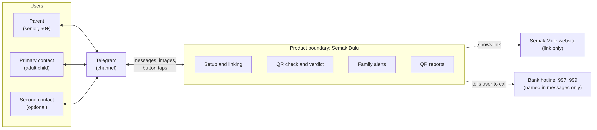
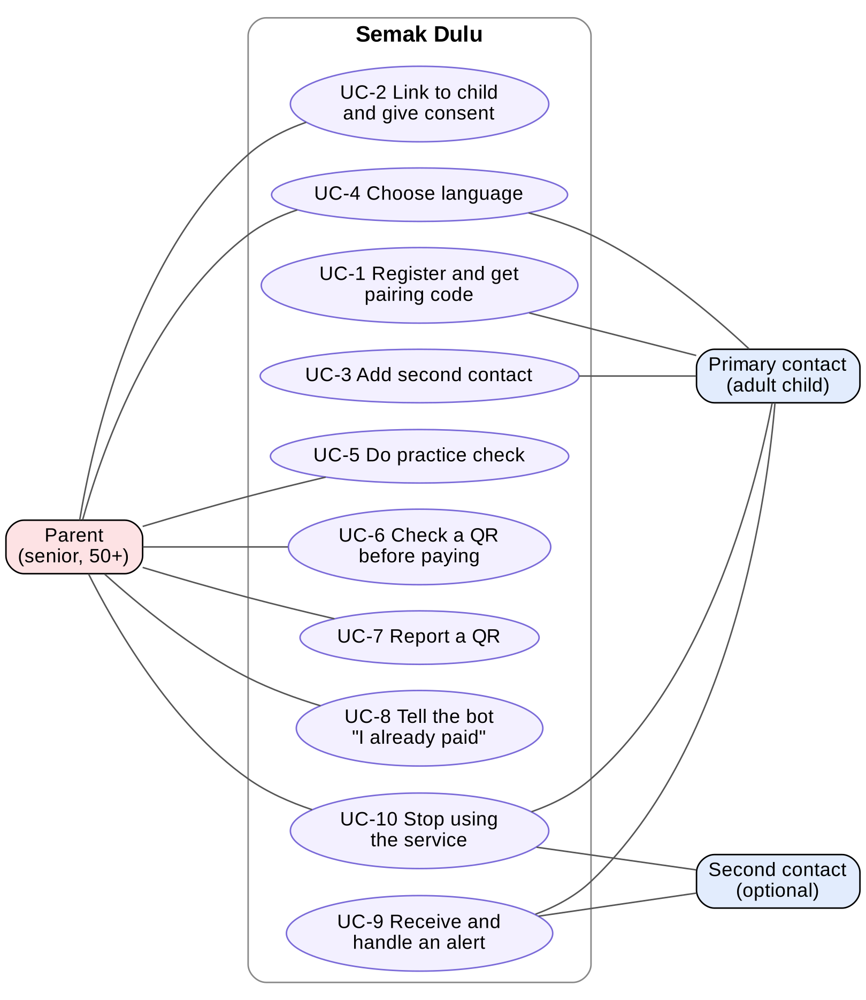
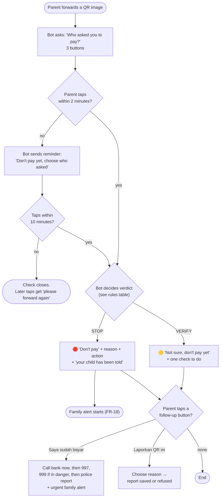
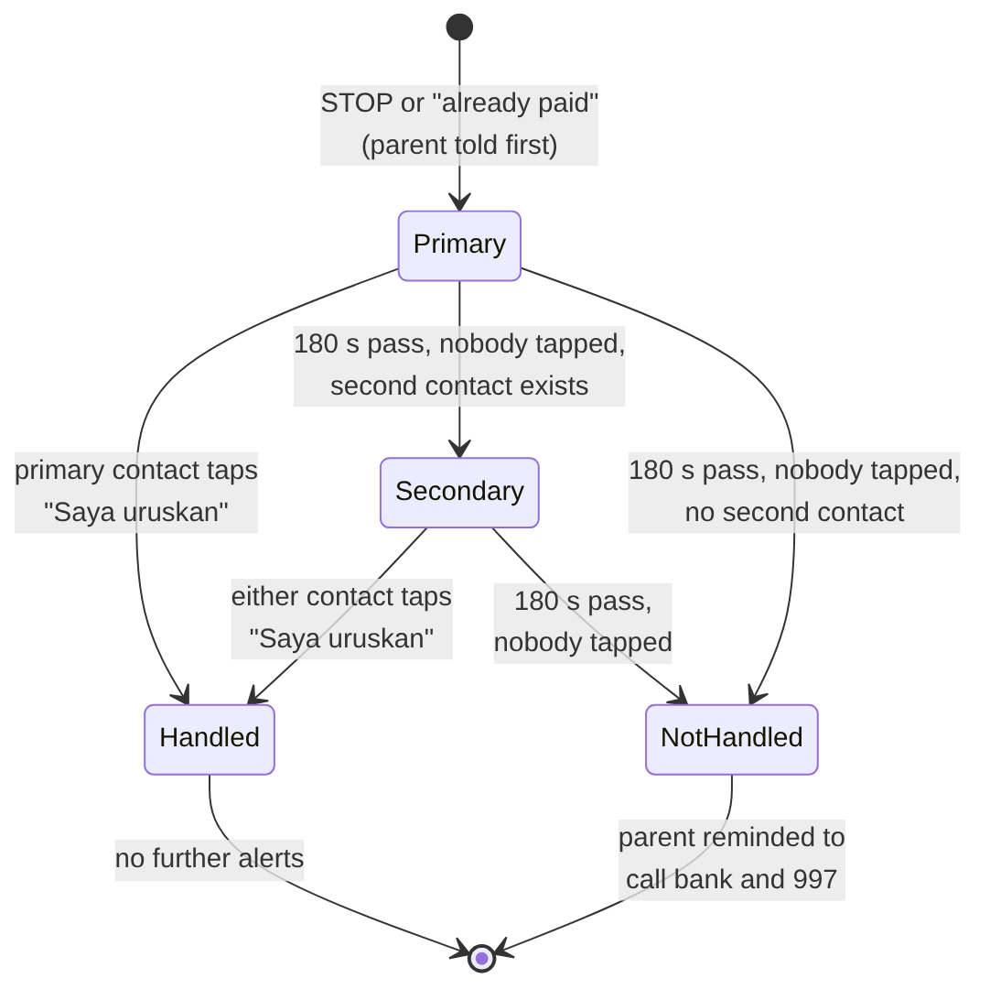
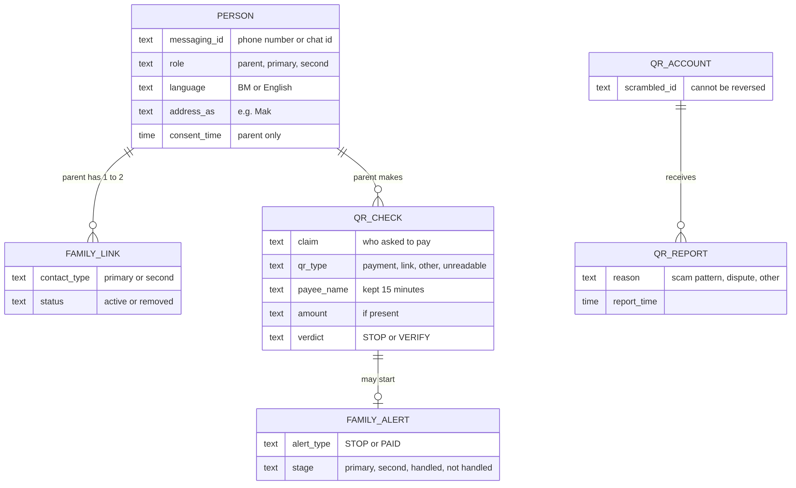

# Semak Dulu: Software Requirements Specification

| | |
|---|---|
| **Product** | Semak Dulu ("Check First"), a Telegram bot that checks payment QR codes for seniors |
| **Track** | Cybersecurity: scam prevention for vulnerable Malaysians |
| **Version** | 1.1, 20 Oct 2026 |
| **Changes in 1.1** | Telegram is the only *channel*. WhatsApp-only constraints were removed. NFR-UI-03 now allows 10 lines and 700 characters. The third question button is "Keluarga/Kawan/Kedai". |
| **Status** | Ready for team review |
| **Related document** | Software Design Document (SDD) v1.1, which describes **how** the system meets these requirements |
| **Template** | Follows the SRS template in "TFB2014 Week 04b: Specifying Requirements" (chapters 1 to 4) |

### How to read this document

This SRS describes **what** the system must do, from the users' point of view. It does not describe **how** the system does it. Implementation details (AWS, queues, databases) are in the SDD. The only exception is section 3.6, which the template asks for.

| Marker | Meaning |
|---|---|
| **FR-nn** | Functional requirement |
| **DR-nn** | Data requirement |
| **NFR-xx-nn** | Non-functional requirement (xx = section, for example UI, US, PF) |
| **Priority** | **M** = Must (MVP fails without it), **S** = Should (planned for the MVP, can be dropped if time runs out), **C** = Could (only if time allows) |
| **AC** | Acceptance criterion: the test that proves the requirement is met |
| **Not applicable** | The template section does not apply to this product (kept, not deleted) |

Words in *italics* inside requirements (for example *parent*, *check*, *verdict*) have the fixed meaning given in the dictionary in section 1.4, and are used only with that meaning.

---

## Contents

1. [Introduction](#1-introduction)
   - 1.1 Background and goals · 1.2 Users · 1.3 Constraints · 1.4 Naming conventions and definitions
2. [Functional and data requirements](#2-functional-and-data-requirements)
   - 2.1 Scope of the product · 2.2 Functional requirements · 2.3 Data requirements
3. [Non-functional requirements](#3-non-functional-requirements)
   - 3.1 Look and feel · 3.2 Usability · 3.3 Performance · 3.4 Maintainability · 3.5 Security · 3.6 Development and target environment · 3.7 Other
4. [References](#4-references)
- [Appendix A: How the writing rules were applied](#appendix-a-how-the-writing-rules-were-applied)
- [Appendix B: Traceability to the SDD](#appendix-b-traceability-to-the-sdd)

---

## 1. Introduction

### 1.1 Background and goals

#### Why is the product needed?

Malaysians lost about RM2.7 billion to cybercrime in 2025 (hackathon brief). People aged 50 and over are among the most targeted. Many of them have low digital literacy.

A common scam follows these steps:

1. A caller pretends to be a trusted person: a bank officer, a police or court officer, a courier, or a friend or relative.
2. The caller creates urgency, for example "we transferred money to you by mistake" or "your account will be frozen".
3. The caller sends a QR code and asks the senior to pay.

The senior believes the caller. General advice such as "don't send money to strangers" does not help, because the senior does not see the caller as a stranger.

#### What work does the user want to do with the product?

| User | Work they want to do |
|---|---|
| *Parent* | Find out, before paying, whether a payment request is likely a scam, without installing anything or typing. |
| *Primary contact* | Set up protection for the parent once, and be told within seconds if the parent is about to pay a likely scammer. |
| *Second contact* | Act as a backup when the primary contact does not respond. |

#### Goals

| ID | Goal | How we measure it |
|---|---|---|
| G-1 | Stop the trusted-caller QR scam at the moment of payment | The system gives a *STOP verdict* in every case where the *parent* says a bank, police or court asked for payment |
| G-2 | Never give false reassurance | No message from the system tells a user that a QR code or a payment is safe (FR-10) |
| G-3 | Bring a family member in quickly | The *primary contact* receives an *alert* within 3 seconds of a *STOP verdict* (NFR-PF-03) |
| G-4 | Be usable by seniors with low digital literacy | A *parent* completes a *check* with 1 forward and 1 tap (NFR-US-01) |
| G-5 | Support Bahasa Melayu | Every message exists in BM, and BM is the default (FR-04) |

#### Not in scope (product boundaries)

The system does **not**: detect AI-cloned voices, scan phishing links, detect deepfake images or videos, connect to MCMC, PDRM or bank databases, or block payments. It gives advice; the *parent* decides.

### 1.2 Users

| User group | Profile | Abilities and knowledge | How they use the product |
|---|---|---|---|
| **Parent** (main user) | Malaysian, 50 years or older. Uses WhatsApp daily for family chats. May have low digital literacy. May be anxious or rushed during a scam call. | Can open a chat app, forward an image, and tap a button. May not be able to type quickly, find files in a gallery, or open a website. BM is the most likely language. | Forwards a QR image, taps one answer, reads the *verdict*. |
| **Primary contact** (set-up user) | Adult son or daughter, typically 25 to 45 years old. Confident smartphone user. Often busy at work. | Can save a contact, type short commands, and follow short instructions. | Sets up the service on a visit, receives *alerts*, taps "Saya uruskan". |
| **Second contact** (optional) | Another family member: sibling, spouse or relative. | Same as the primary contact. | Receives *alerts* only when the primary contact does not respond. |

### 1.3 Constraints

#### Assumptions

| ID | Assumption | Status |
|---|---|---|
| AS-2 | A DuitNow QR code with merchant category code `0000` belongs to a personal account. This held for 3 of 3 personal QR codes tested. | Accepted |
| AS-3 | The value `A0000006150001` in tag 26 identifies a DuitNow QR code. | Accepted |
| AS-4 | The *parent* forwards the QR image to the system before paying. The setup visit and practice check build this habit. | Accepted risk: the system cannot help a *parent* who does not forward. |
| AS-5 | The *parent* and *contacts* have a smartphone with Telegram and a mobile data connection. | Accepted |

#### Constraints

| ID | Constraint | Source |
|---|---|---|
| CO-1 | The system must support Bahasa Melayu. | Hackathon requirement |
| CO-3 | The team has 3 to 4 developers. | Team |
| CO-7 | The system must comply with Malaysia's Personal Data Protection Act 2010 (PDPA). | Law |
| CO-8 | The system must use free tiers or minimal-cost cloud services during the hackathon. | Budget |

### 1.4 Naming conventions and definitions

This dictionary defines every term used in the requirements. Terms in *italics* in the requirements have exactly this meaning.

| Term | Definition |
|---|---|
| **System** | The Semak Dulu bot, including its logic and stored data. It does not include Telegram itself. |
| **Parent** | A user who is linked to at least one *contact* and has given *consent*. The person the system protects. |
| **Contact** | A *primary contact* or a *second contact*. |
| **Primary contact** | The user who registered the *parent*. Exactly one per *parent*. |
| **Second contact** | An optional extra family member linked to the *parent*. At most one per *parent*. |
| **Channel** | The messaging app used to talk to the *system*: Telegram. |
| **Pairing code** | A 6-character code that the *system* gives the *primary contact*, used once to link the *parent*. Valid for 24 hours. |
| **Consent** | The *parent's* tap on the "Setuju" button, which allows the *system* to send *alerts* about them. |
| **Check** | One QR verification, from the moment the *parent* forwards an image until the *system* sends a *verdict* or the *check* expires. |
| **Claim** | The *parent's* answer to "Who asked you to pay?". One of three values: **OFFICIAL** (bank, police or court), **COURIER**, or **KNOWN_PERSON** (relative, friend or seller). |
| **Payment QR** | A QR code that follows the EMVCo payment format. |
| **DuitNow QR** | A *payment QR* whose tag 26 contains the DuitNow identifier (AS-3). |
| **Personal account** | A *DuitNow QR* whose merchant category code (tag 52) is `0000` (AS-2). |
| **Business account** | A *DuitNow QR* whose merchant category code is any value other than `0000`. |
| **Static QR / dynamic QR** | Static: reusable, tag 01 = `11`, no amount. Dynamic: for one payment, tag 01 = `12`, usually includes an amount. |
| **Payee name** | The name stored in tag 59 of a *payment QR*. |
| **Verdict** | The *system's* answer to a *check*. Exactly one of two values: *STOP* or *VERIFY*. There is no third value. |
| **STOP verdict** | The *verdict* that tells the *parent* not to pay. It starts an *alert*. |
| **VERIFY verdict** | The *verdict* that tells the *parent* not to pay yet, and gives one check to do first. |
| **Action** | One concrete step that the *parent* can finish in under 60 seconds, for example "call the person back on a number you already saved". |
| **Alert** | A message that the *system* sends to a *contact* after a *STOP verdict* or a *paid report*. |
| **Acknowledge** | A *contact* tapping the "Saya uruskan" (I'm handling it) button on an *alert*. |
| **Escalation** | Sending an *alert* to the *second contact* because the *primary contact* has not *acknowledged* it within 180 seconds. |
| **Paid report** | The *parent* tapping "Saya sudah bayar" (I already paid). |
| **QR report** | A user's statement, by tapping a reason, that a QR code was used in a scam or a dispute. |
| **Scam-pattern report** | A *QR report* with the reason "the caller pretended to be a bank, police, court or courier". Only this kind counts as evidence. |
| **Reportable QR** | A *static* *DuitNow QR*. Only these can receive *QR reports*. |
| **Evidence level** | The number of different users who made a *scam-pattern report* about the same *reportable QR*: none (0), few (1 to 2), or several (3 or more). |
| **Family code word** | A secret word that the *parent* and *contacts* agree in person, used to confirm a caller's identity. The *system* never stores it. |
| **Safety claim** | Any message text that states or implies that a QR code, an account or a payment is safe, for example "selamat", "boleh bayar", "tiada masalah", "safe to pay". A sentence that negates safety, such as "itu tidak bermakna ia selamat", is not a *safety claim*. |
| **Practice check** | A *check* done during setup with a test QR, clearly marked as a demo. |
| **BM** | Bahasa Melayu |
| **MVP** | Minimum viable product: the version delivered on 21 Oct 2026 |
| **PDPA** | Personal Data Protection Act 2010 (Malaysia) |
| **EMVCo** | The organisation that sets the international payment QR standard |
| **TLV** | Tag-length-value: how a *payment QR* stores its fields |
| **MCC** | Merchant category code (tag 52) |
| **NSRC / 997** | National Scam Response Centre hotline |
| **Semak Mule** | PDRM's public website for checking whether an account or phone number has been reported in scams |

---

## 2. Functional and data requirements

### 2.1 Scope of the product

The *system* sits between the users and the messaging *channels*. It has four functional areas: setup and linking, QR check and verdict, family alerts, and QR reports.

#### Interfaces to adjacent systems

| Adjacent system | Data the system consumes | Data the system produces | Type |
|---|---|---|---|
| Telegram (*channel*) | Text messages, images, button taps, sender chat ID | Text messages, messages with up to 3 buttons | Two-way, automated |
| Semak Mule website | Nothing | A link inside some messages | Link only, no automated exchange |
| Banks, NSRC (997), emergency services (999) | Nothing | Phone numbers or names in messages | Named only, no automated exchange |

#### Use cases

| ID | Use case | Actor | Requirements |
|---|---|---|---|
| UC-1 | Register and get a *pairing code* | *Primary contact* | FR-01 |
| UC-2 | Link to the *primary contact* and give *consent* | *Parent* | FR-02 |
| UC-3 | Add a *second contact* | *Primary contact*, *second contact* | FR-03 |
| UC-4 | Choose a language | Any user | FR-04 |
| UC-5 | Do a *practice check* | *Parent* | FR-21 |
| UC-6 | Check a QR before paying | *Parent* | FR-05 to FR-12, FR-24 to FR-26 |
| UC-7 | Report a QR | *Parent* | FR-14 to FR-17 |
| UC-8 | Tell the system "I already paid" | *Parent* | FR-13 |
| UC-9 | Receive and *acknowledge* an *alert* | *Primary contact*, *second contact* | FR-18 to FR-20 |
| UC-10 | Stop using the service | Any user | FR-22 |

A *STOP verdict* in UC-6 and a *paid report* in UC-8 both start UC-9.

### 2.2 Functional requirements

Requirements are grouped by functional area. Each has an ID, a priority and an acceptance criterion (AC). IDs FR-01 to FR-20 match the earlier requirement list and the SDD. FR-21 to FR-27 were added while writing this SRS to cover cases the earlier list left out.

#### 2.2.1 Setup and linking

| ID | Requirement | Priority | Acceptance criterion |
|---|---|---|---|
| **FR-01** | When a user who is not yet registered sends the word "Daftar", the *system* shall register that user as a *primary contact*, ask how to address the *parent* (for example "Mak" or "Ayah"), store the answer, and send the *primary contact* a *pairing code* that is valid for 24 hours. | M | A new user sends "Daftar" and "Mak". The system replies with a 6-character code. The same code is rejected 24 hours later. |
| **FR-02** | When a user sends a valid, unused *pairing code*, the *system* shall show that user a short explanation that the *system* will message their *primary contact* if it gives a *STOP verdict*, together with a "Setuju" button. When the user taps "Setuju", the *system* shall record the user as a *parent*, link them to the *primary contact*, record the time of *consent*, mark the *pairing code* as used, and confirm the link to both users. If the user does not tap "Setuju", the *system* shall not link the users and shall not send *alerts* about them. If the *pairing code* is invalid, used or expired, the *system* shall tell the user that the code does not work and ask them to get a new code from their family member. | M | (1) Valid code + "Setuju": both users receive a confirmation, and the consent time is stored. (2) Valid code, no tap: no link exists. (3) Expired code: the user receives the "code does not work" message. |
| **FR-03** | When a *primary contact* sends the word "Tambah", the *system* shall send them a second *pairing code*. When another user sends that code and taps "Terima" (accept), the *system* shall link that user to the *parent* as the *second contact*. If the *parent* already has a *second contact*, the *system* shall tell the *primary contact* to remove the existing one first. A *parent* without a *second contact* shall receive the full service. | S | (1) A second user links successfully and later receives an escalated alert (FR-20). (2) A third link attempt is refused. (3) All tests for FR-05 to FR-19 pass for a parent with no second contact. |
| **FR-04** | When a user sends their first message to the *system*, the *system* shall ask them to choose "Bahasa Melayu" or "English" with two buttons, and shall use BM until the user chooses. The *system* shall send every later message to that user in the chosen language. The user shall be able to change the language at any time by sending "Bahasa" or "Language". | M | (1) A first message receives the language buttons. (2) After choosing English, all messages are in English. (3) A user who never taps receives BM. |
| **FR-21** | After a *parent* gives *consent*, the *system* shall invite the *parent* to forward a test QR code. When the *parent* forwards any image during this *practice check*, the *system* shall reply with a sample *verdict* that is clearly labelled "[LATIHAN]" (practice), and shall not send any *alert*. | S | The parent forwards an image after linking. The reply carries the practice label, and no contact receives an alert. |
| **FR-22** | When any user sends the word "Berhenti", the *system* shall ask the user to confirm with a button. After confirmation, the *system* shall delete that user's profile and all links that include the user, stop sending them messages, and confirm the deletion. If the user is a *parent*, the *system* shall also tell their *contacts* that the *parent* has left the service. | M | After "Berhenti" and confirmation, the user's profile and links no longer exist, and a forwarded QR image from that user is treated as coming from a new user. |
| **FR-23** | When a user sends text that the *system* does not recognise as a command, the *system* shall reply with a short help message that tells the user to forward a QR image, and lists the available commands. | S | Sending "hello" returns the help message. |

#### 2.2.2 QR check

| ID | Requirement | Priority | Acceptance criterion |
|---|---|---|---|
| **FR-05** | The *system* shall accept an image that a user forwards or sends in a Telegram chat, as the start of a *check*. The user shall not need to install any app other than Telegram, and shall not need to type anything to start a *check*. | M | Forwarding a QR screenshot from another chat starts a check. |
| **FR-06** | For each image in a *check*, the *system* shall classify the content as exactly one of: *DuitNow QR*, other *payment QR*, web link, other text, no QR code found, or unreadable image. | M | Each test image in the fixture set (SDD section 11.2) receives its expected class. |
| **FR-07** | For each *DuitNow QR*, the *system* shall extract the *payee name*, whether it is *static* or *dynamic*, the amount (if the QR contains one), and whether it is a *personal account* or a *business account*. If a field is missing from the QR, the *system* shall record that field as unknown and shall not guess it. | M | The 5 sample QR codes return the expected payee name, type, amount and account type. A QR without tag 52 returns "account type unknown". |
| **FR-08** | Within 3 seconds of receiving an image, the *system* shall ask the *parent* "Who asked you to pay?" with exactly 3 buttons: "Bank/Polis/Mahkamah" (*claim* OFFICIAL), "Kurier" (*claim* COURIER), and "Keluarga/Kawan/Kedai" (*claim* KNOWN_PERSON). The *system* shall send this question before the result of FR-06 is known. | M | The question with 3 buttons arrives for every forwarded image, including blurry images and images without a QR code. |
| **FR-09** | The *system* shall give a *STOP verdict* in exactly these two cases: (a) the *claim* is OFFICIAL, whatever the image contains, including when no QR code could be read; (b) the *claim* is COURIER and the image contains a *DuitNow QR* for a *personal account*. The *system* shall make this decision without using any *QR reports*. | M | Test matrix in section 2.2.3: every STOP row returns STOP, with an empty report store. |
| **FR-10** | In every case not covered by FR-09, the *system* shall give a *VERIFY verdict*. No message that the *system* sends, in any language, to any user, shall contain a *safety claim*. | M | (1) Every VERIFY row in section 2.2.3 returns VERIFY. (2) An automated scan of every message text in both languages finds no safety claim. |
| **FR-11** | Every *verdict* message shall start with the instruction ("JANGAN BAYAR" for *STOP*, "Tunggu dulu, jangan bayar dahulu" for *VERIFY*), followed by one reason in one sentence and exactly one *action*. If the QR contains a *payee name*, the *VERIFY verdict* shall show it. | M | Review of every verdict message: the first line is the instruction, and exactly one action is present. |
| **FR-12** | When the content is a web link, other text, no QR code, an unreadable image, or a *payment QR* that is not a *DuitNow QR*, the *system* shall send a message written for that specific case, which tells the *parent* not to pay yet and what to do next. The *system* shall never open a web link found in a QR code. The *system* shall not show technical error text to the user. | M | Each of the 5 failure cases produces its own message. Logs show no outgoing request to the URL in the test link QR. |
| **FR-24** | If the *parent* has not tapped a *claim* button within 120 seconds after the question (FR-08), the *system* shall send one reminder that starts with "Jangan bayar dahulu" and repeats the 3 buttons. If the *parent* still has not tapped within 10 minutes after the question, the *system* shall close the *check*. | S | (1) No tap for 2 minutes: exactly one reminder arrives. (2) No tap for 10 minutes: the check is closed (see FR-25). |
| **FR-25** | When the *parent* taps a button that belongs to a closed or replaced *check*, the *system* shall reply that the check has expired and ask the *parent* to forward the QR image again. | S | Tapping an 11-minute-old button returns the "expired" message, and no verdict is given. |
| **FR-26** | When the *parent* forwards a new image while a *check* is still open, the *system* shall close the old *check* and start a new one with the new image. | S | Two images sent 10 seconds apart: only the second receives a verdict. |
| **FR-13** | Every *verdict* message shall include a "Saya sudah bayar" button. When the *parent* taps it, the *system* shall (1) tell the *parent*, in this order, to call their bank immediately, call 997, call 999 if they are in danger, and then make a police report; and (2) start a *PAID alert* (FR-18). | M | Tapping the button returns the 4 steps in order, and the primary contact receives the PAID alert. |

#### 2.2.3 Verdict rules (decision table)

This table defines FR-09 and FR-10 completely. Every combination has exactly one result.

| Rule | *Claim* | QR content | *Verdict* | Starts an *alert*? |
|---|---|---|---|---|
| V-1 | OFFICIAL | Any, including no QR or unreadable | **STOP** | Yes |
| V-2 | COURIER | *DuitNow QR*, *personal account* | **STOP** | Yes |
| V-3 | COURIER | No QR, unreadable, web link, other text, or non-DuitNow *payment QR* | VERIFY ("we could not check this QR") | No |
| V-4 | COURIER | *DuitNow QR*, *business account* or account type unknown | VERIFY (show the merchant name, check it in the courier's official app) | No |
| V-5 | KNOWN_PERSON | Any | VERIFY (show the *payee name*, call back on a saved number, ask the *family code word*) | No |

The *evidence level* (FR-15) adds one line to any *verdict*. It never changes the *verdict* or whether an *alert* starts.

#### 2.2.4 QR reports

| ID | Requirement | Priority | Acceptance criterion |
|---|---|---|---|
| **FR-14** | Every *verdict* message shall include a "Laporkan QR ini" button. When the user taps it, the *system* shall show 3 reason buttons: "Pemanggil menyamar sebagai bank, polis, mahkamah atau kurier" (*scam-pattern report*), "Penjual atau orang itu tidak jujur" (dispute), and "Lain-lain" (other). The *system* shall store the *QR report* with the chosen reason and thank the user. | S | A report with each reason is stored with that reason. |
| **FR-15** | When a *check* contains a *reportable QR*, the *system* shall add one line to the *verdict* that depends on the *evidence level*: none: "Tiada laporan dijumpai, tetapi itu tidak bermakna ia selamat"; few: "Akaun ini ada {n} laporan yang belum disahkan. Berhati-hati."; several: "Beberapa orang telah melaporkan akaun ini." The *system* shall not use the word "penipu" (scammer) in any of these lines. Dispute and other reports shall not count toward the *evidence level*. | S | A QR with 0, 2 and 3 scam-pattern reports from different users shows the 3 lines. 5 dispute reports leave the level at none. |
| **FR-16** | The *system* shall accept at most one *QR report* per user per *reportable QR*. When the same user reports the same QR again, the *system* shall tell them that their report already exists. The *system* shall accept *QR reports* only for *reportable QRs*. For any other QR, the *system* shall tell the user that this QR cannot be reported. | S | (1) A second report from the same user is refused. (2) A report on a dynamic QR is refused, and nothing is stored. |
| **FR-17** | The *VERIFY verdict* message shall include a link to the Semak Mule website, with a one-line suggestion to check the account there. The *system* shall not use Semak Mule results to decide a *verdict*. | C | The link appears in VERIFY messages and not in the verdict logic. |

#### 2.2.5 Family alerts

| ID | Requirement | Priority | Acceptance criterion |
|---|---|---|---|
| **FR-18** | The *system* shall send an *alert* to the *primary contact* in exactly two cases: after a *STOP verdict*, and after a *paid report*. The *system* shall not send an *alert* after a *VERIFY verdict*. The *alert* shall start with "AMARAN: Telefon {address_as} sekarang." and shall state: who the caller claimed to be; whether the QR was a *personal account*, a *business account*, or could not be read; that the *system* does not know whether money was sent (STOP alert) or that the *parent* reported paying (PAID alert); a reminder to ask the *family code word*; and a "Saya uruskan" button. | M | (1) A STOP verdict produces an alert with all 5 elements. (2) A VERIFY verdict produces no alert. (3) A paid report produces a PAID alert. |
| **FR-19** | Before the *system* sends an *alert* after a *STOP verdict*, the *STOP verdict* message to the *parent* shall tell the *parent* not to pay, to end the call, and that their *primary contact* has been told and will call them. | M | The parent's STOP message arrives before the contact's alert and contains all 3 statements. |
| **FR-20** | If no *contact* has *acknowledged* an *alert* 180 seconds after it was sent, and a *second contact* exists, the *system* shall send the same *alert* to the *second contact*. If no *contact* has *acknowledged* it 180 seconds after that, or if no *second contact* exists, the *system* shall send the *parent* a message telling them to call their bank and 997. As soon as any *contact acknowledges* the *alert*, the *system* shall send no further messages about that *alert* and shall tell the other *contact* (if alerted) that someone is handling it. The *system* shall send each *alert* to at most 2 *contacts*. | M | (1) No ack: the second contact is alerted at 180 ± 30 s. (2) Ack by the primary contact at 60 s: the second contact receives nothing. (3) No second contact and no ack: the parent receives the bank and 997 message at 180 ± 30 s. (4) Double tap on "Saya uruskan": exactly one confirmation. |
| **FR-27** | When a *contact* taps "Saya uruskan", the *system* shall confirm to that *contact* that the *alert* is marked as handled. | M | The contact receives a confirmation within 3 seconds. |

### 2.3 Data requirements

#### 2.3.1 Data needed by the product

| Data | Source | Used for |
|---|---|---|
| Messaging ID (phone number or Telegram chat ID) | *Channel* | Identifying users and sending messages |
| Chosen language | User (FR-04) | Choosing message text |
| Address name ("Mak", "Ayah") | *Primary contact* (FR-01) | Personalising messages |
| Consent time | *Parent* (FR-02) | Proving *consent* before *alerts* |
| Family links (primary, second) | Setup (FR-02, FR-03) | Knowing whom to *alert* |
| QR image | *Parent* (FR-05) | Decoding only |
| QR fields: *payee name*, amount, type, account type | Decoded from the QR image (FR-07) | *Verdict* and messages |
| *Claim* | *Parent* (FR-08) | *Verdict* |
| *Alert* stage | *System* (FR-18 to FR-20) | *Escalation* |
| *QR reports*: scrambled QR account ID, reason, time | Users (FR-14) | *Evidence level* |

#### 2.3.2 Data stored persistently, and for how long

| ID | Requirement | Priority | AC |
|---|---|---|---|
| **DR-01** | The *system* shall not store any QR image. The *system* shall delete each image from memory as soon as decoding finishes. | M | No image file or image bytes exist in any data store after a check. |
| **DR-02** | The *system* shall store the decoded QR fields and the *claim* of a *check* for at most 15 minutes after the *check* starts, and shall then delete them. | M | A check's data cannot be read 16 minutes after it started. |
| **DR-03** | The *system* shall not store raw bank account numbers or raw QR payloads. For *QR reports*, the *system* shall store only a scrambled QR account ID that cannot be turned back into the account number without a secret key. | M | Inspection of stored reports shows no account digits and no payloads. |
| **DR-04** | The *system* shall store user profiles and family links until the user sends "Berhenti" (FR-22). | M | Profiles remain after 30 days of no use, and disappear after "Berhenti". |
| **DR-05** | The *system* shall store *pairing codes* for at most 24 hours. | M | Code unusable and deleted after 24 hours. |
| **DR-06** | The *system* shall store *alert* records for at most 7 days. | S | Alert record deleted after 7 days. |
| **DR-07** | The *system* shall store *QR reports* (scrambled ID, reason, time, scrambled reporter ID) with no expiry date for the MVP. | S | Reports remain after 30 days. |
| **DR-08** | The *system* shall never store the *family code word*. | M | No message flow asks the user to type the code word. |
| **DR-09** | System logs shall not contain QR payloads, *payee names*, account numbers or full phone numbers. The *system* shall keep logs for at most 14 days. | M | Log review during testing finds none of these items. Log retention setting is 14 days. |

#### 2.3.3 Data volume

The MVP is sized for the hackathon demo and testing only.

| Item | Expected volume (MVP) |
|---|---|
| Registered users | Up to 10 (hackathon demo) |
| *Checks* per day | Up to 200 (during testing) |
| QR image size | Up to 5 MB per image. Larger images are rejected with a message asking for a normal photo or screenshot. |
| Stored data per user | Under 2 KB for the profile and links |
| Stored data per *check* | Under 2 KB, deleted after 15 minutes |
| *QR reports* | Up to 500 in total |

---

## 3. Non-functional requirements

### 3.1 Look and feel / user interface

The user interface consists of chat messages inside Telegram. The *system* does not have its own app, website or screens.

| ID | Requirement | Priority | AC |
|---|---|---|---|
| **NFR-UI-01** | The *system* shall communicate only through text messages and buttons inside the *channel*. The *system* shall not send images, voice notes, videos or files to users in the MVP. | M | Message log contains only text and button messages. |
| **NFR-UI-02** | A message shall contain at most 3 buttons. Each button label shall be at most 20 characters long. | M | Automated check of the message catalogue. |
| **NFR-UI-03** | A *verdict* or *alert* message shall be at most 10 lines and at most 700 characters long, including the *evidence level* line. | M | Automated check of the message catalogue with the longest variable values. |
| **NFR-UI-04** | A *STOP verdict* shall begin with the 🛑 symbol and the words "JANGAN BAYAR". A *VERIFY verdict* shall begin with the 🟡 symbol and the words "Tunggu dulu". The symbol shall never be the only signal of the *verdict*. | M | Review of the message catalogue. |
| **NFR-UI-05** | Messages shall address the *parent* with the name chosen by the *primary contact* (FR-01). | S | A parent registered as "Ayah" sees "Ayah" in the messages. |

### 3.2 Usability

| ID | Requirement | Priority | AC |
|---|---|---|---|
| **NFR-US-01** | A *parent* shall be able to complete a *check*, from forwarding the image to reading the *verdict*, with 1 forward action and 1 button tap, and with no typing. | M | Count of user actions in the demo script. |
| **NFR-US-02** | A *primary contact* shall be able to complete setup (FR-01, FR-02, FR-21) together with the *parent* in under 5 minutes, without reading any documentation other than the bot's messages. | S | 2 test pairs complete setup in under 5 minutes each. |
| **NFR-US-03** | At least 2 of 3 test users aged 50 or over shall complete a *practice check* without help from the team. | S | User test before 19 Oct 2026, results recorded. |
| **NFR-US-04** | Messages shall use everyday BM or English words. Messages shall not contain these technical terms: "payload", "merchant", "EMV", "TLV", "MCC", "checksum", "error code". | M | Automated word scan of the message catalogue. |
| **NFR-US-05** | Every message that the *system* sends to a *parent* shall end with either buttons or one *action*. | M | Review of the message catalogue. |
| **NFR-US-06** | The *VERIFY verdict* for the KNOWN_PERSON *claim* and every *alert* shall remind the user to ask the *family code word*. During setup, the *system* shall suggest that the *parent* and *contact* agree a *family code word* in person, and shall state that the *system* will never ask for it. | S | Review of the 3 messages. |
| **NFR-US-07** | A native BM speaker shall review every BM message before the demo. | M | Review recorded with name and date. |
| **NFR-US-08** | The users need no training. The setup message from the *primary contact* to the *parent* (SDD section 6.1) is the only instruction. | M | Not testable separately. Covered by NFR-US-02 and NFR-US-03. |

### 3.3 Performance

Times are measured from the moment the *channel* delivers the user's message to the *system* until the *system* hands its reply to the *channel*. Network delivery time to the phone is not included.

| ID | Requirement | Priority | AC |
|---|---|---|---|
| **NFR-PF-01** | The *system* shall send the "Who asked you to pay?" question (FR-08) within 3 seconds for at least 95% of *checks*. | M | 20 timed test checks. |
| **NFR-PF-02** | The *system* shall send the *verdict* within 3 seconds of the *claim* tap for at least 95% of *checks*. | M | 20 timed test checks. |
| **NFR-PF-03** | The *system* shall send the *alert* to the *primary contact* within 3 seconds of sending the *STOP verdict*. | M | 10 timed STOP tests. |
| **NFR-PF-04** | The *system* shall send the *escalation* (FR-20) and the reminder (FR-24) within ±30 seconds of their target times (180 seconds and 120 seconds). | S | 5 timed tests each. |
| **NFR-PF-05** | The *system* shall read the QR code correctly in at least 9 of 10 clear screenshots of QR codes, and in at least 6 of 10 photos of a QR code taken from a phone screen. | S | Test with the fixture image set. |
| **NFR-PF-06** | The *system* shall process up to 10 *checks* at the same time from different *parents* without any reply taking longer than the limits in NFR-PF-01 and NFR-PF-02. | C | Load test with 10 parallel checks. |

**Memory and hardware:** Not applicable for users (the *system* runs in the cloud). Server-side limits are in the SDD.

### 3.4 Maintainability

| ID | Requirement | Priority | AC |
|---|---|---|---|
| **NFR-MT-01** | **Expected operating time:** the MVP shall run from 19 Oct 2026 until the end of the hackathon evaluation period. | M | System available during the evaluation period. |
| **NFR-MT-02** | The team shall be able to change any message text, in either language, by editing a text file, without changing program code. | M | Change one message, redeploy, see the new text. |
| **NFR-MT-03** | The team shall be able to add a new *channel* (for example a third messaging app) by adding one new adapter module, without changing the verdict rules or the message text. | S | Telegram is added this way (code review). |
| **NFR-MT-04** | **Extension points:** the design shall allow these additions later without rewriting the verdict rules: a phishing link check, a voice-note check that can only make a *verdict* stricter, new languages, new *claim* types, and official scam database lookups. | S | Design review against the SDD. |
| **NFR-MT-05** | Automated tests shall cover every row of the decision table in section 2.2.3 and every failure case in FR-12. | M | Test report lists each row and case. |
| **NFR-MT-06** | The team shall keep all code, tests and documents in one Git repository with a README that explains how to deploy the *system* in at most 10 steps. | M | A team member who did not write the README deploys from it. |

### 3.5 Security

| ID | Requirement | Priority | AC |
|---|---|---|---|
| **NFR-SE-01** | **Transmission:** all data between the *channels* and the *system* shall travel over HTTPS (TLS 1.2 or later). | M | Endpoint test rejects plain HTTP. |
| **NFR-SE-02** | **Authenticity:** the *system* shall process only requests that carry a valid signature or secret token from Telegram. The *system* shall reject every other request without processing it. | M | A request with a wrong signature returns an error and produces no reply. |
| **NFR-SE-03** | **Data access:** only the *system's* own cloud functions and the team's named administrators shall have access to stored data. Each cloud function shall have only the permissions it needs. | M | Permission review. |
| **NFR-SE-04** | **Secrets:** access tokens and the scrambling key shall not appear in the code repository or in logs. | M | Repository and log scan finds no secrets. |
| **NFR-SE-05** | **Abuse limits:** the *system* shall accept at most 10 *checks* per user per 10 minutes. When a user exceeds this limit, the *system* shall tell them to wait. | S | The 11th check within 10 minutes receives the "please wait" message. |
| **NFR-SE-06** | **Pairing codes** shall be random, single-use, at least 6 characters long, and shall exclude look-alike characters (0, O, 1, I). | M | Code generator unit test. |
| **NFR-SE-07** | **Consent and privacy notice:** before linking, the *system* shall tell the *parent* what data it keeps, why, and how to delete it ("Berhenti"). | M | The consent message (FR-02) contains these 3 items. |
| **NFR-SE-08** | **PDPA:** the *system* shall meet the obligations of the PDPA that apply to this processing. | M | Review against the 7 PDPA principles: General, Notice and Choice, Disclosure, Security, Retention, Data Integrity, and Access. |
| **NFR-SE-09** | **Report abuse:** the *system* shall limit the effect of false *QR reports* by applying FR-15 (only *scam-pattern reports* count), FR-16 (one per user per QR) and FR-09 (reports never cause a *STOP verdict*). | M | Covered by the ACs of FR-09, FR-15 and FR-16. |

### 3.6 Development and target environment

| Item | Development environment | Target environment |
|---|---|---|
| User device | Not applicable | Any Android or iOS smartphone with a current Telegram version |
| Channels | Telegram Bot API | Same. WhatsApp is future work (SDD section 17). |
| Programming language | Python 3.12 | Python 3.12 |
| Cloud platform | Amazon Web Services, serverless (Lambda, API Gateway, SQS, DynamoDB) | Same |
| Region | Asia Pacific (Malaysia) if available, otherwise Asia Pacific (Singapore) | Same |
| Database | Amazon DynamoDB | Same |
| Infrastructure as code | AWS SAM | Same |
| Testing | pytest, moto, a simulated channel | Not applicable |
| Version control | Git (GitHub) | Not applicable |
| Main libraries | zxing-cpp, OpenCV, Pillow, boto3, PyYAML | Same |

### 3.7 Other non-functional requirements

#### System support

| ID | Requirement | Priority |
|---|---|---|
| **NFR-SU-01** | The *system* shall reply to the word "Bantuan" or "Help" with the help message (FR-23). | M |
| **NFR-SU-02** | The team shall receive an automatic notification when any event fails 3 times. | S |

#### Legal and ethical

| ID | Requirement | Priority |
|---|---|---|
| **NFR-LE-01** | The welcome message shall state that Semak Dulu is not a bank, the police or a government service, and that it gives advice only. | M |
| **NFR-LE-02** | No message shall call a specific person or account a scammer ("penipu"). | M |

---

## 4. References

| # | Reference |
|---|---|
| [1] | Hackathon brief: Cybersecurity track (problem statement, RM2.7 billion figure, MVP and stretch goals) |
| [2] | Semak Dulu Software Design Document v1.0, 14 Oct 2026 (`docs/SDD.md`) |
| [3] | T. Anwar, "TFB2014 Software Engineering and Human Computer Interfaces, Week 04b: Specifying Requirements", lecture slides, Faculty of Science, Management and Computing, 2026 (slides © H. Lichter, RWTH Aachen) |
| [4] | S. Robertson, J. Robertson, *Mastering the Requirements Process*, Addison-Wesley, 1999 |
| [5] | IEEE Std 830-1998, *IEEE Recommended Practice for Software Requirements Specifications* |
| [6] | C. Rupp, "Linguistic methods of Requirements Engineering (NLP)", EuroSPI, 2000 |
| [9] | Telegram, *Telegram Bot API* documentation, core.telegram.org/bots/api |
| [10] | EMVCo, *EMV QR Code Specification for Payment Systems: Merchant-Presented Mode* |
| [11] | PayNet, *DuitNow QR* specification |
| [12] | Personal Data Protection Act 2010 (Act 709), Malaysia |
| [13] | PDRM Semak Mule website, semakmule.rmp.gov.my |

---

## Appendix A: How the writing rules were applied

The lecture's rules R1 to R6 were applied to every requirement. These examples show the main changes from the earlier requirement list.

| Rule | Earlier wording | Problem | Wording in this SRS |
|---|---|---|---|
| R1 Active voice | "The bot accepts a forwarded image... with no installs" | Unclear who installs | FR-05: "The user shall not need to install any app other than Telegram" |
| R2 Main verbs | "Reports separate scam-pattern reasons from seller disputes" | "Separate" hides the process | FR-15: "Dispute and other reports shall not count toward the evidence level" |
| R3 Complete process words | "The bot tells them to call their bank and 999" | Who, in what order, and what else happens? | FR-13: 4 steps in order, plus the PAID alert to the primary contact |
| R4 Comparatives | "Wording scales with evidence", "a stronger warning" | Stronger than what? | FR-15: 3 evidence levels with fixed counts and fixed text |
| R4 Quantify | "after about 3 minutes" | "About" is vague | FR-20: 180 seconds, NFR-PF-04: ±30 seconds |
| R5 Universal quantifiers | "It never says a QR is safe" | Which messages? Which languages? What counts as "safe"? | FR-10: "No message... in any language, to any user, shall contain a *safety claim*", with *safety claim* defined in 1.4, including the negated exception |
| R5 Universal quantifiers | "Every verdict leads with the action" | Does it apply to failure messages too? | FR-11 covers *verdicts*, FR-12 covers failure cases, NFR-US-05 covers all messages to *parents* |
| R6 Incomplete conditions | "The alert fires only on a firm STOP" | What happens on VERIFY? And after "already paid"? | FR-18: exactly two triggers, and an explicit "shall not" for VERIFY |
| R6 Incomplete conditions | "If the child hasn't tapped after 3 minutes, alert the second contact" | What if there is no second contact? What if nobody responds to the second alert? | FR-20 covers all 3 outcomes |
| Nouns without reference | "the bot", "the parent" | Not defined | Defined in 1.4 as *system* and *parent* |
| Nominalisation | "consent for the child alert" | Who gives it, how, and what if they refuse? | FR-02: the parent taps "Setuju", the system records the time, and without it no link exists |

## Appendix B: Traceability to the SDD

| Requirement | SDD section | SDD test scenario |
|---|---|---|
| FR-01, FR-02, FR-21 | 6.1 Setup flow, 3.2 Data | Setup walkthrough |
| FR-03, FR-20 | 5.4 Alerts and escalation | S8 |
| FR-04 | 6.4 Message catalogue | Catalogue tests |
| FR-05, FR-08 | 2.2 Architecture, 6.2 Check flow | S1 |
| FR-06, FR-07, FR-12 | 5.2 Decoding pipeline, 3.5 QR findings | Fixture tests, S2, S6 |
| FR-09, FR-10, FR-11 | 5.3 Verdict engine | S1 to S5, safety phrase test |
| FR-13, FR-18, FR-19, FR-27 | 5.4 Alerts | S1, S9 |
| FR-14 to FR-17 | 5.5 Reports | S11, S12 |
| FR-22 | 9 Security and privacy | S14 |
| FR-23, FR-25 | 4.4 Error handling | S13 |
| FR-24, FR-26 | 5.6 Pending checks | S7 |
| DR-01 to DR-09 | 3.6 Retention, 9.2 Privacy | Data inspection |
| NFR-PF-01 to 04 | 2.6 Performance targets | Timed tests |
| NFR-SE-01 to 09 | 9 Security and privacy | Security review |
